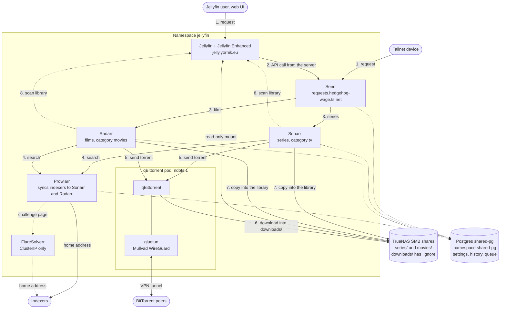
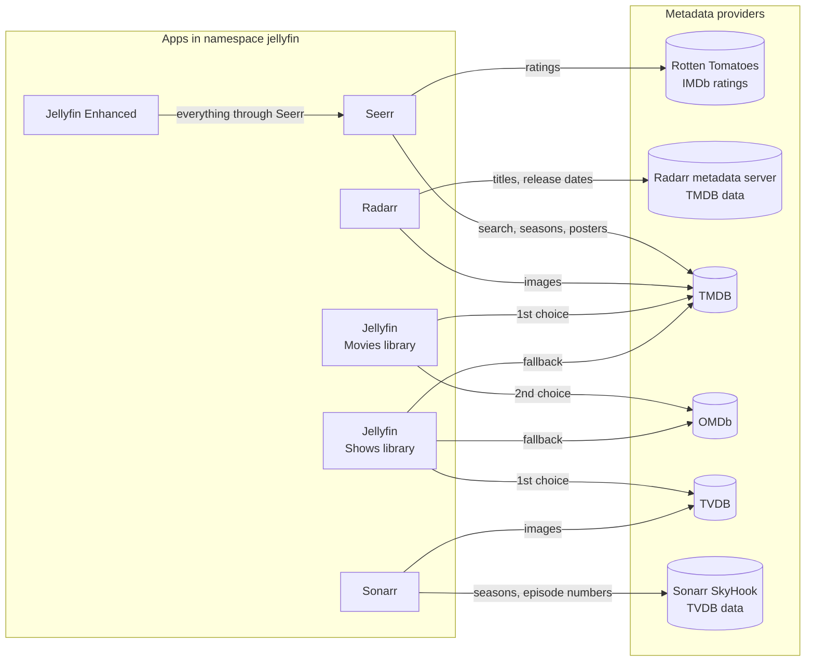

# Seerr, Sonarr, Radarr, Prowlarr and Jellyfin Enhanced

Seerr takes media requests from Jellyfin users. Sonarr finds a series and Radarr finds a film, through the indexers in Prowlarr. Both hand the download to qBittorrent. FlareSolverr solves the Cloudflare challenge of an indexer for Prowlarr. Jellyfin Enhanced adds the request screens to the Jellyfin web UI. This file says how the parts connect, how to set them up and how to check them.

| Part | Address | Public route |
|---|---|---|
| Seerr | `https://requests.hedgehog-wage.ts.net` | none |
| Sonarr | `https://sonarr.hedgehog-wage.ts.net` | none |
| Radarr | `https://radarr.hedgehog-wage.ts.net` | none |
| Prowlarr | `https://prowlarr.hedgehog-wage.ts.net` | none |
| qBittorrent | `https://qbittorrent.hedgehog-wage.ts.net` | none |
| FlareSolverr | `http://flaresolverr:8191`, in the cluster only | none |
| Jellyfin | `https://jelly.yornik.eu` | yes, as before |

## How the parts connect



All calls between the parts stay in the `jellyfin` namespace. The only exception is the database: Seerr, Sonarr, Radarr and Prowlarr keep their data in the Postgres cluster `shared-pg`, in the namespace `shared-pg`. See [`../tech/database.md`](../tech/database.md).

| From | To | Address in the cluster |
|---|---|---|
| Jellyfin Enhanced | Seerr | `http://seerr:5055` |
| Seerr | Jellyfin | `http://jellyfin:8096` |
| Seerr | Sonarr | `http://sonarr:8989` |
| Seerr | Radarr | `http://radarr:7878` |
| Sonarr, Radarr | qBittorrent | `http://qbittorrent:8080` |
| Prowlarr | Sonarr | `http://sonarr:8989` |
| Prowlarr | Radarr | `http://radarr:7878` |
| Sonarr, Radarr | Prowlarr | `http://prowlarr:9696` |
| Prowlarr | FlareSolverr | `http://flaresolverr:8191` |
| Seerr, Sonarr, Radarr, Prowlarr | `shared-pg` | `shared-pg-rw.shared-pg.svc.cluster.local:5432` |

Jellyfin stays on its public address. Jellyfin Enhanced calls Seerr from the Jellyfin server, not from the browser. A user without the tailnet can request media in the Jellyfin web UI. Only the links that open the Seerr UI need the tailnet.

NOTE: Seerr has no download client. It sends a series request to Sonarr and a film request to Radarr. That program picks the release and hands it to qBittorrent.

### Where the metadata comes from



| App | Provider | What it fetches |
|---|---|---|
| Seerr | TMDB | Search, titles, seasons, posters. It sends the TMDB id to Radarr and the TVDB id, read from TMDB, to Sonarr. |
| Seerr | Rotten Tomatoes, IMDb | Ratings on the detail page. A title without ratings returns 404, which Jellyfin Enhanced logs as a warning. |
| Jellyfin Enhanced | Seerr | Everything about requests, through the Jellyfin server. It calls no provider itself. |
| Radarr | Radarr metadata server (TMDB data), TMDB | Film titles, years and release dates; images from `image.tmdb.org`. |
| Sonarr | Sonarr SkyHook (TVDB data), TVDB | Seasons, episode numbers and air dates; images from `artworks.thetvdb.com`. |
| Jellyfin, Movies library | TMDB, then OMDb | Film metadata and images. |
| Jellyfin, Shows library | TheTVDB plugin, then TMDB and OMDb | Series, season and episode metadata and images. TVDB comes first, so the season numbers match Sonarr. |
| Intro Skipper | none | Finds intros and credits from the audio of the local files. |

NOTE: Seerr counts seasons as TMDB does, and Sonarr counts them as TVDB does. For an anime with a long break, TMDB can list a later season as more episodes of season 1. A request for "season 1" in Seerr then monitors only TVDB season 1 in Sonarr. Monitor the other seasons in Sonarr.

## What the repository sets

- `manifests/seerr/`, `manifests/sonarr/`, `manifests/radarr/`, `manifests/prowlarr/` and `manifests/flaresolverr/` run in the `jellyfin` namespace, next to Jellyfin and qBittorrent.
- Sonarr mounts the `qbittorrent-series-rw` volume at `/media/series`, the same path as qBittorrent. A download needs no remote path mapping.
- Radarr mounts the `qbittorrent-movies-rw` volume at `/media/movies` in the same way.
- Sonarr forces its login on for every address. Without this setting, Sonarr skips the login for a pod address, and the Tailscale proxy connects from one. The repository does not set the login method, so a new Sonarr shows the dialog that creates the first user.
- Radarr and Prowlarr force their login on for every address, the same way as Sonarr.
- Prowlarr has no VPN. Public indexers block the Mullvad exit addresses quickly, so searches leave from the home address. Only qBittorrent downloads, and it stays behind Mullvad.
- FlareSolverr has a ClusterIP Service and nothing else. It has no tailnet address, no public route and no volume. It has no login, so anyone who reaches it can make it open any address from the home network. Only Prowlarr is set up to use it.
- FlareSolverr has no VPN, for the same reason as Prowlarr. A solved challenge belongs to the address that solved it. Prowlarr reuses the result, so both must leave from the home address.
- Seerr, Sonarr, Radarr and Prowlarr keep their data in Postgres on `shared-pg`, not in SQLite on their volume. Each Servarr app has a `-main` and a `-log` database. Seerr has 1 database, `seerr`. The password of each app is in `manifests/<app>/postgres.enc.yaml`.
- The move from SQLite was on 2026-10-28 and 2026-10-29. SQLite took an NFS lock for each transaction, and Sonarr and Radarr froze for 25 to 30 seconds at a time. The old SQLite files stay on the volumes as a fallback. See [`../tech/database.md`](../tech/database.md#how-the-servarr-apps-moved-from-sqlite).
- Jellyfin is unchanged. It keeps its own SQLite database on a `local-path` volume, not on NFS.

## How to activate the new tailnet devices

Follow [`tailnet-only-admin-uis.md`](tailnet-only-admin-uis.md#after-the-merge). Sign the devices `requests`, `sonarr`, `radarr` and `prowlarr`.

WARNING: Each address is unreachable until you sign its device. The Applications still sync in the meantime.

NOTE: FlareSolverr has no device. It has no tailnet address, so there is nothing to sign.

## How to set up Seerr

1. Open `https://requests.hedgehog-wage.ts.net`.
2. Choose Jellyfin as the media server.
3. Enter `http://jellyfin:8096` and sign in as a Jellyfin administrator.
4. Enable the Jellyfin libraries for series and films.
5. Open Settings, then Network, and turn on Enable Proxy Support.
6. Open Settings, then Users, and turn on Enable Jellyfin Sign-In.
7. Import the Jellyfin users.

WARNING: The first visitor to a new Seerr completes the setup wizard and becomes the administrator. Do steps 1 to 4 before you tell anyone the address.

Each person who requests media needs a Seerr account that links to the Jellyfin user.

## How to set up qBittorrent

Do this once. qBittorrent keeps its categories in its own config, not in git.

NOTE: Create the categories before Sonarr and Radarr use them. A category that Sonarr or Radarr creates gets the default save path, `/media/movies/`. Sonarr cannot see that share, and for Radarr it is the root of the film library.

1. Open the qBittorrent WebUI.
2. In the left sidebar, under Categories, right-click All.
3. Choose Add category.
4. Add a category named `tv` with save path `/media/series/downloads/`.
5. Add a category named `movies` with save path `/media/movies/downloads/`.
6. Open Tools, then Options, then BitTorrent.
7. Under Seeding Limits, turn on When ratio reaches and enter `1`.
8. Turn on When total seeding time reaches and enter `120` minutes.
9. Turn on When inactive seeding time reaches and enter `120` minutes.
10. Set then to Stop torrent, and save.

Expected result: a finished download of category `tv` sits under `/media/series/downloads/`, and one of category `movies` under `/media/movies/downloads/`. The init containers of Sonarr and Radarr create these folders and put an empty `.ignore` file in each, so Jellyfin does not scan them as library folders.

Expected result: about 2 hours after a download finishes, qBittorrent stops the torrent. Sonarr or Radarr then removes the torrent and its files in `downloads/`.

NOTE: Sonarr and Radarr remove a stopped torrent only when Remove Completed is on for the qBittorrent download client. It is on by default. On 2026-10-24 it was on in both apps.

NOTE: The seeding limits keep a download from using space twice for long. Sonarr and Radarr copy a download into the library, because the SMB share has no hardlinks. Seeding longer brings little: Mullvad has no port forwarding, so other peers cannot connect to qBittorrent. On 2026-10-24 the ratios after 20 hours were 0.00 to 0.46.

NOTE: The seeding time counts only the time that a torrent seeds, not the time since it finished. A torrent that waits in the upload queue does not count. With a limit of 24 hours, about 400 GB of copies stayed in `downloads/` for more than a day.

## How to set up Sonarr

WARNING: The first visitor to a new Sonarr creates the login. Do steps 1 and 2 right after you sign the `sonarr` device.

1. Open `https://sonarr.hedgehog-wage.ts.net`.
2. In the Authentication Required dialog, choose Forms and create the administrator account.
3. Open Settings, then Media Management, and add the root folder `/media/series`.
4. Open Settings, then Download Clients, and add qBittorrent.
5. Enter host `qbittorrent`, port `8080` and the WebUI user and password of qBittorrent.
6. Enter category `tv`.
7. Open Settings, then Media Management, and turn off Set Permissions.
8. In the same page, turn off Use Hardlinks instead of Copy.
9. Open Settings, then General, and copy the API key.

NOTE: Sonarr needs an indexer to find a release. Without one, a request stays open. Do not add indexers in Sonarr. Prowlarr adds them. See [How to set up Prowlarr](#how-to-set-up-prowlarr).

NOTE: An SMB share does not allow a permission change or a hardlink. Step 7 stops Sonarr from trying one. Step 8 makes Sonarr copy a finished download, so a download uses space twice until Sonarr removes the torrent. The seeding limits in [How to set up qBittorrent](#how-to-set-up-qbittorrent) make that happen after about 2 hours.

## How to set up Radarr

WARNING: The first visitor to a new Radarr creates the login. Do steps 1 and 2 right after you sign the `radarr` device.

1. Open `https://radarr.hedgehog-wage.ts.net`.
2. In the Authentication Required dialog, choose Forms and create the administrator account.
3. Open Settings, then Media Management, and add the root folder `/media/movies`.
4. Open Settings, then Download Clients, and add qBittorrent.
5. Enter host `qbittorrent`, port `8080` and the WebUI user and password of qBittorrent.
6. Enter category `movies`.
7. Open Settings, then Media Management, and turn off Set Permissions.
8. In the same page, turn off Use Hardlinks instead of Copy.
9. Open Settings, then General, and copy the API key.

NOTE: Click Show Advanced at the top of a settings page if a setting is not there.

## How to set up Prowlarr

WARNING: The first visitor to a new Prowlarr creates the login. Do steps 1 and 2 right after you sign the `prowlarr` device.

1. Open `https://prowlarr.hedgehog-wage.ts.net`.
2. In the Authentication Required dialog, choose Forms and create the administrator account.
3. Open Indexers and add your indexers.
4. Open Settings, then Apps, and add Sonarr.
5. Enter Prowlarr Server `http://prowlarr:9696`.
6. Enter Sonarr Server `http://sonarr:8989`.
7. Enter the API key from Sonarr.
8. Press Test, then Save.
9. Add Radarr in the same way, with Radarr Server `http://radarr:7878` and the API key from Radarr.

Expected result: Settings, then Indexers, in Sonarr and in Radarr lists each indexer from Prowlarr. Prowlarr keeps the lists in sync. A change in Prowlarr reaches both without a step in Sonarr or Radarr.

NOTE: Some public indexers block automated clients behind a challenge page. Prowlarr then reports the indexer as failed. Prowlarr uses FlareSolverr for these indexers. See [How to set up FlareSolverr](#how-to-set-up-flaresolverr).

## How to set up FlareSolverr

FlareSolverr starts a browser, opens the challenge page of an indexer and returns the cookies. Prowlarr then uses the cookies for its own requests. The repository runs FlareSolverr. Prowlarr does not use it until you add it as an indexer proxy.

NOTE: Use FlareSolverr for an indexer that fails its test with a Cloudflare or "challenge" error only. A browser start is slow and uses memory. An indexer without the tag does not use it.

1. Open `https://prowlarr.hedgehog-wage.ts.net`.
2. Open Settings, then Indexers.
3. Under Indexer Proxies, press the plus sign and choose FlareSolverr.
4. Enter the name `flaresolverr`.
5. Enter the tag `flaresolverr`.
6. Enter the host `http://flaresolverr:8191`.
7. Enter the request timeout `60`.
8. Press Test, then Save.
9. Open the indexer that fails. Add the tag `flaresolverr` to it. Press Save.

Expected result: the test of the indexer passes. Prowlarr sends only the indexers with the tag through FlareSolverr.

NOTE: The tag in step 5 and the tag in step 9 must be the same. If the tags differ, Prowlarr does not use the proxy for that indexer.

CAUTION: FlareSolverr has no login and no tailnet address. Do not change the Service type. Do not add an Ingress or a Tailscale annotation for it. Anyone who reaches it can make it open any address from the home network, including the NAS and the cluster. The cluster does not enforce NetworkPolicy, so a pod in any namespace can call it. See the CNI row in [`../tech/README.md`](../tech/README.md).

## Recyclarr

`manifests/recyclarr/` runs Recyclarr every hour, at minute 17, as a CronJob. It syncs 2 TRaSH Guides profiles into Sonarr and into Radarr. It does not change the other profiles.

| Profile | Use it for | Qualities |
|---|---|---|
| `Remux 2160p (Alternative)` | Films and normal series | 2160p remux first, then 2160p Bluray and WEB, then 1080p and 720p. A title without a 4K release still downloads. |
| `[Anime] Remux-1080p` | Anime | BD and WEB 1080p first, then 720p. No 2160p, because most anime 2160p releases are upscales. |

| Custom formats | Effect |
|---|---|
| Unwanted Formats | -10000 for BR-DISK, LQ groups, upscales and 3D. Neither profile takes them. |
| Golden Rule UHD | Refuses x265 encodes of 1080p sources. |
| Release group tiers | Remux, UHD Bluray, anime BD and anime WEB groups ranked by quality. |
| Dubs Only | -10000 in the anime profile, so a release always has the Japanese audio. Anime Dual Audio stays at 0: an English dub is neither preferred nor refused. |

Recyclarr also applies these TRaSH Guides settings to the whole app, for Sonarr and Radarr:

| Setting | Value | Effect |
|---|---|---|
| Quality sizes | TRaSH `movie` sizes in Radarr, `anime` sizes in Sonarr | No maximum size. A minimum size per quality refuses fake releases. |
| Propers and repacks | Do not Prefer | The Repack custom formats decide. |
| Naming | TRaSH Jellyfin formats with `[tmdbid-…]` and `[tvdbid-…]` | Jellyfin matches new titles by ID. Only new imports get the new names. To rename existing files, select the titles, then click Rename Files. |

NOTE: The anime profile sets a minimum custom format score of 100. A release from a group that the anime tiers do not know is refused.

With the quality equal, Sonarr prefers a season pack over single episodes. Before these profiles, a single 2160p anime episode won over a 1080p BD season pack.

The API keys are in `manifests/recyclarr/secret.enc.yaml`. If you create a new API key in Sonarr or Radarr, update that file.

NOTE: Recyclarr keeps the IDs of the custom formats it created on the `recyclarr-config-ssd` volume. Without that volume it cannot update them.

### How to use the profiles

1. In Seerr, open Settings, then Services, and edit Radarr.
2. Set Quality Profile to `Remux 2160p (Alternative)`.
3. Set Anime Quality Profile to `[Anime] Remux-1080p`.
4. Save, and edit Sonarr.
5. Set Quality Profile to `Remux 2160p (Alternative)`.
6. Set Anime Quality Profile to `[Anime] Remux-1080p`.
7. Set Anime Series Type to Anime, and save.
8. In Radarr, open Movies and click Select Movies.
9. Select the films, click Edit, and set Quality Profile.
10. In Sonarr, do step 8 and step 9 for the series. Give anime `[Anime] Remux-1080p`.

### How to run it now

CAUTION: Do not start a manual run near minute 17 of the hour. A job made with `create job --from` does not obey `concurrencyPolicy: Forbid`, so it can run at the same time as the scheduled run. Both jobs mount `recyclarr-config-ssd`, which is `ReadWriteOnce`. On another node the second pod waits with `FailedAttachVolume`. On the same node both pods write the same state in `/config/state`.

1. Start the job and follow its log:

   ```sh
   kubectl -n jellyfin create job --from=cronjob/recyclarr recyclarr-manual
   kubectl -n jellyfin logs -f job/recyclarr-manual
   ```

2. Delete the job when it is done. Until `ttlSecondsAfterFinished` (24 hours) removes it, the name `recyclarr-manual` stays taken and the next `create job` with that name fails.

   ```sh
   kubectl -n jellyfin delete job recyclarr-manual
   ```

## How to connect Seerr to Sonarr and Radarr

1. In Seerr, open Settings, then Services, and add a Sonarr server.
2. Enter host `sonarr`, port `8989` and the API key from Sonarr.
3. Choose the root folder `/media/series` and a quality profile.
4. Turn on Enable Automatic Search.
5. Press Test, then Save.
6. In the same page, add a Radarr server.
7. Enter host `radarr`, port `7878` and the API key from Radarr.
8. Choose the root folder `/media/movies` and a quality profile.
9. Turn on Enable Automatic Search.
10. Press Test, then Save.

## How to install Jellyfin Enhanced

Jellyfin Enhanced works with Jellyfin 10.11 and 12.x.

1. In Jellyfin, open Dashboard, then Plugins, then Repositories.
2. Add the repository `https://raw.githubusercontent.com/n00bcodr/jellyfin-plugins/main/manifest.json`.
3. Open the Catalog, choose Jellyfin Enhanced and install it.
4. Restart Jellyfin. A browser refresh does not load the plugin.
5. Open Dashboard, then Plugins, then Jellyfin Enhanced, then Seerr.
6. Turn on Enable Seerr integration.
7. Enter `http://seerr:5055` as the Seerr URL.
8. Enter the API key from Seerr, Settings, General.
9. Press Test, then Save Settings.
10. Under Advanced URL Mappings, map `http://seerr:5055` to `https://requests.hedgehog-wage.ts.net`.

Expected result: the Jellyfin web UI shows a request button on titles that are not in the library. The mapping in step 10 makes the links that open Seerr use an address a browser can reach.

NOTE: The plugin stores its settings in the Jellyfin config volume. A restore of that volume brings them back. The plugin itself is not in git.

CAUTION: The plugin changes the Jellyfin web UI. If Jellyfin does not start after step 4, remove the Jellyfin Enhanced folder from `/config/plugins` on the Jellyfin config volume and start Jellyfin again.

## How the SMB share permissions work

Sonarr and qBittorrent mount the `qbittorrent-series-rw` volume. Jellyfin mounts the same share as `jellyfin-series`. Radarr, qBittorrent and Jellyfin use the movies share in the same way, through `qbittorrent-movies-rw` and `jellyfin-movies`.

| Volume | Mount options | Effect |
|---|---|---|
| `qbittorrent-series-rw` | `uid=1000`, `gid=1000`, `dir_mode=0775`, `file_mode=0664` | Every file looks owned by user 1000. This matches `PUID` and `PGID` in the Sonarr and qBittorrent pods. |
| `jellyfin-series` | `ro`, `dir_mode=0555`, `file_mode=0444` | Jellyfin reads every file and cannot write. The mount is read-only, not the NAS. |

The mount options only change how the files look in the pod. The SMB account in `smb-credentials` decides what can be written. Both volumes use that account.

If a write fails, the cause is the account on the NAS, not the pod user. Give the account write access to the `series` and `movies` folders.

NOTE: No ZFS ACL change on the NAS is needed. Checked on 2026-10-23 from the qBittorrent pod, as user 1000. A new folder and a new file in `/media/series` were written and removed. Jellyfin read the new file at once and could not write.

### How to check the share

Run these commands once after the merge.

1. Write a file from the Sonarr pod:

   ```sh
   kubectl -n jellyfin exec deploy/sonarr -- sh -c 'touch /media/series/downloads/.write-test && rm /media/series/downloads/.write-test && echo writable'
   ```

   Expected result: `writable`.

2. List the folder from the Jellyfin pod:

   ```sh
   kubectl -n jellyfin exec deploy/jellyfin -- ls -a /media/series/downloads
   ```

   Expected result: the listing shows `.ignore`.

3. Try a write from the Jellyfin pod:

   ```sh
   kubectl -n jellyfin exec deploy/jellyfin -- touch /media/series/downloads/.write-test
   ```

   Expected result: the command fails with `Read-only file system`. If it succeeds, the Jellyfin mount is not read-only. Fix `manifests/jellyfin/pv-series.yaml` first.

4. Repeat steps 1 to 3 for the movies share. Use `deploy/radarr` in step 1 and `/media/movies/downloads` in each command.

If step 1 returns `Permission denied` or `Read-only file system`, give the SMB account write access to that folder on the NAS.

## How to check

1. Check that the pods run:

   ```sh
   kubectl -n jellyfin get pods -l 'app in (seerr,sonarr,radarr,prowlarr,flaresolverr)'
   ```

2. Check that Seerr answers:

   ```sh
   curl -sS https://requests.hedgehog-wage.ts.net/api/v1/status
   ```

3. Check the SMB share. See [How to check the share](#how-to-check-the-share).
4. Check that Sonarr asks for a login. The command must return a redirect or a 401, not the Sonarr page:

   ```sh
   curl -sSI https://sonarr.hedgehog-wage.ts.net/api/v3/system/status
   ```

5. Check that Radarr asks for a login. The command must return a redirect or a 401:

   ```sh
   curl -sSI https://radarr.hedgehog-wage.ts.net/api/v3/system/status
   ```

6. Check that Prowlarr asks for a login. The command must return a redirect or a 401:

   ```sh
   curl -sSI https://prowlarr.hedgehog-wage.ts.net/api/v1/system/status
   ```

7. Check that FlareSolverr answers. The command must print `{"status": "ok"}`:

   ```sh
   kubectl -n jellyfin exec deploy/flaresolverr -- curl -sS http://localhost:8191/health
   ```

8. Check that Prowlarr reaches FlareSolverr. The command must print `{"status": "ok"}`:

   ```sh
   kubectl -n jellyfin exec deploy/prowlarr -- curl -sS http://flaresolverr:8191/health
   ```

9. Check that FlareSolverr has no address outside the cluster. The command must show the type `ClusterIP` and `<none>` under `EXTERNAL-IP`:

   ```sh
   kubectl -n jellyfin get service flaresolverr
   ```

## How to undo

WARNING: ArgoCD deletes `seerr-config-ssd`, `sonarr-config-ssd`, `radarr-config-ssd` and `prowlarr-config-ssd` with the Applications. They hold the config file and the old SQLite fallback of each program. Copy the files out of the volumes first if you want to keep them.

NOTE: The databases on `shared-pg` stay when the Applications go. Each `Database` resource has `databaseReclaimPolicy: retain`. To remove the data, remove the entries from `manifests/shared-pg/databases.yaml` and `manifests/shared-pg/cluster.yaml`, then drop the databases by hand.

1. Remove the `seerr`, `sonarr`, `radarr`, `prowlarr` and `flaresolverr` entries from `apps/values.yaml`.
2. Merge the change. ArgoCD prunes the Applications.
3. Remove the devices from the Tailscale admin console. FlareSolverr has none.

NOTE: FlareSolverr keeps no data, so its removal loses nothing. Prowlarr keeps the indexer proxy and the tags in its own config. If you remove FlareSolverr alone, delete the proxy in Prowlarr. Until then the indexers with the tag fail their test.

The `qbittorrent-series-rw` and `qbittorrent-movies-rw` volumes stay. The `qbittorrent` Application owns them.
