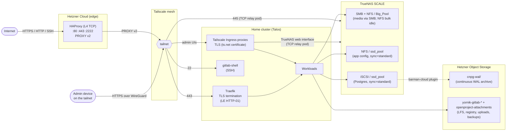
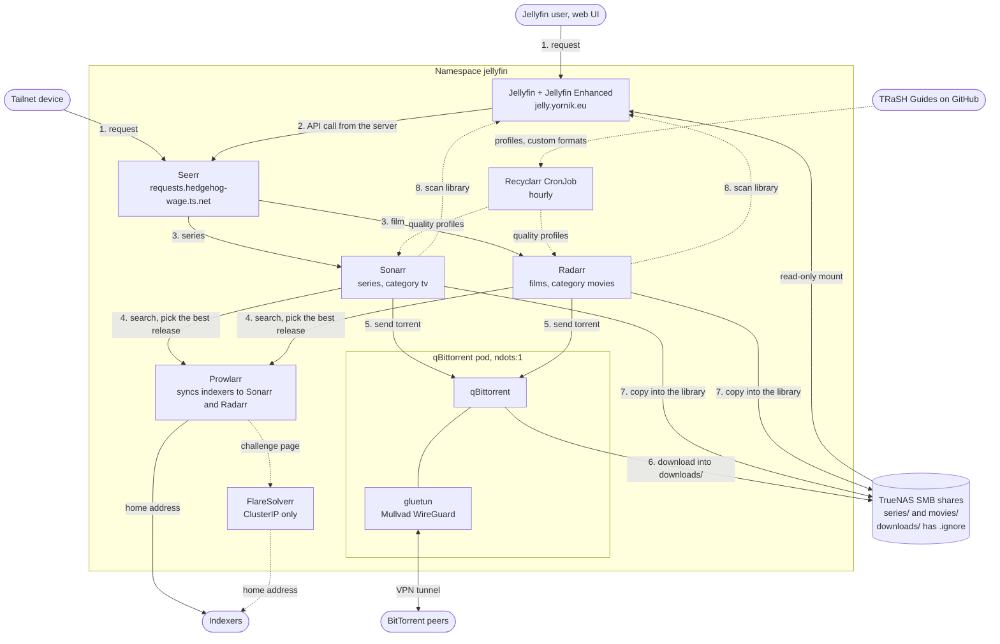
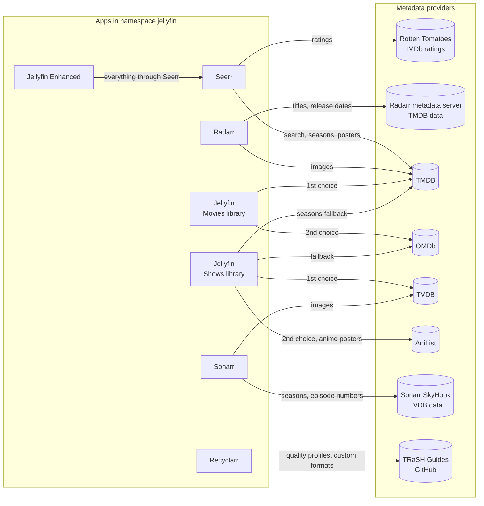

# sharkshere-gitops — technical overview

> Moved from the repository root. The root `README.md` is the short operator-facing version; this file keeps the full narrative, diagrams and inventories. Incident write-ups live in [`../incidents/`](../incidents/README.md).

GitOps control plane for the sharkshere homelab platform — a 4-node Talos Kubernetes cluster reconciling 54 ArgoCD Applications that serve 15 public HTTPS domains end-to-end, including self-hosted **GitLab CE** (with container registry on `registry.git.yornik.eu` and git-over-SSH on `:2222`), **OpenProject**, **Vaultwarden**, **Jellyfin**, and a Fediverse instance.

Traffic enters via two Hetzner edge nodes (HAProxy L4 TCP with PROXY v2 preserving real client IPs), tunnels through a Tailscale mesh, and terminates TLS at in-cluster Traefik via ACME (Let's Encrypt HTTP-01).

The admin interfaces do not take that path. The ArgoCD UI, Grafana, Alertmanager, ArchiSteamFarm, qBittorrent, Seerr, Sonarr, Radarr, Prowlarr, the Vaultwarden admin panel and the TrueNAS web interface are reachable from a tailnet device only, through Tailscale Ingress proxies that terminate TLS with a `ts.net` certificate. See [Tailnet only](#tailnet-only).

This repo is one of three:

| Repo | Layer | Responsibility |
|---|---|---|
| [`jumpingsharks`](https://github.com/Yornik/jumpingsharks) | infrastructure | provisions Hetzner edge hosts + DNS/rDNS via OpenTofu |
| [`sharkshere-ansible`](https://github.com/Yornik/sharkshere-ansible) | hosts | hardens edge hosts, deploys HAProxy + Tailscale + fail2ban |
| `sharkshere-gitops` (this repo) | workloads | reconciles in-cluster apps + runtime policy via ArgoCD |

## At a glance

| Metric | Value |
|---|---|
| Nodes | 4× Intel N150 (3 control-plane + 1 worker, all schedulable), Talos Linux |
| CNI | Flannel (`ghcr.io/siderolabs/flannel`), the Talos default. It does not enforce NetworkPolicy, so the NetworkPolicy objects in `argocd`, `openproject`, `go-practice` and `go-practice-runner` have no effect. Checked on 2026-10-17. |
| Kubelet | `podPidsLimit: 4096` and `seccompDefault: true` on all 4 nodes. Omni manages this configuration, not this repository. The PID limit is an Omni cluster config patch on `machine.kubelet.extraConfig`, applied on 2026-10-21. Talos v1.14 marks `machine.kubelet` deprecated, but this cluster's config uses it: a `KubeletConfig` document next to it fails with "kubelet config is already set in v1alpha1 config". |
| Memory | 128 GiB cluster total |
| Workloads | 54 ArgoCD Applications, 15 public HTTPS domains, 11 tailnet-only web interfaces, 1 tailnet-only SMB service |
| Postgres | 4 CloudNativePG Clusters (shared / OpenProject / GitLab / soiree), 3-instance HA each |
| Object storage | 8 buckets in Hetzner Object Storage (WAL archive + per-app backends) |
| Edge | 2 Hetzner jump hosts (Nuremberg + Helsinki) with HAProxy L4 + Tailscale |
| Storage backend | TrueNAS SCALE (7-disk raidz1 HDD pool + 2-disk SSD mirror) over NFS + iSCSI + SMB |
| Logs | Alloy (DaemonSet) → Loki (60-day retention, 30 GiB store) |
| Metrics | kube-prometheus-stack + Grafana with file-provider dashboards |
| Secrets | SOPS + age, decrypted in-cluster by KSOPS in the ArgoCD repo-server |

## Traffic + state flow



## Media request flow

A request for a series or a film runs through these steps. All calls between the apps stay in the `jellyfin` namespace. Only qBittorrent goes through Mullvad. Setup and checks are in [`../runbooks/seerr-sonarr.md`](../runbooks/seerr-sonarr.md).



In step 4, Sonarr and Radarr score each release with the quality profile of the title. Recyclarr syncs these profiles from the TRaSH Guides every hour:

- `Remux 2160p (Alternative)` for films and normal series.
- `[Anime] Remux-1080p` for anime.

Both profiles refuse BR-DISK, LQ groups, upscales and 3D. Details are in [`../runbooks/seerr-sonarr.md`](../runbooks/seerr-sonarr.md#recyclarr).

### Where the metadata comes from

Each app asks a different provider. TMDB and TVDB number the seasons of some series in a different way.



| App | Provider | What it fetches |
|---|---|---|
| Seerr | TMDB | Search, titles, seasons, posters. It sends the TMDB id to Radarr and the TVDB id, read from TMDB, to Sonarr. |
| Seerr | Rotten Tomatoes, IMDb | Ratings on the detail page. A title without ratings returns 404, which Jellyfin Enhanced logs as a warning. |
| Jellyfin Enhanced | Seerr | Everything about requests, through the Jellyfin server. It calls no provider itself. |
| Radarr | Radarr metadata server (TMDB data), TMDB | Film titles, years and release dates; images from `image.tmdb.org`. |
| Sonarr | Sonarr SkyHook (TVDB data), TVDB | Seasons, episode numbers and air dates; images from `artworks.thetvdb.com`. |
| Jellyfin, Movies library | TMDB, then OMDb | Film metadata and images. |
| Jellyfin, Shows library | TheTVDB plugin, AniList plugin, TMDB, OMDb | Series metadata from TVDB, then AniList, then OMDb. Season metadata from TVDB, then TMDB. Episode metadata from AniList, then TVDB, TMDB and OMDb. Posters from AniList first. TVDB comes first for series and seasons, so the season numbers match Sonarr. AniList only answers for anime. |
| Recyclarr | TRaSH Guides on GitHub | Quality profiles, custom formats and release group tiers. It writes them into Sonarr and Radarr, which then score the releases from Prowlarr. No title metadata. |
| Intro Skipper | none | Finds intros and credits from the audio of the local files. |

NOTE: Seerr counts seasons as TMDB does, and Sonarr counts them as TVDB does. For an anime with a long break, TMDB can list a later season as more episodes of season 1. A request for "season 1" in Seerr then monitors only TVDB season 1 in Sonarr. Monitor the other seasons in Sonarr.

NOTE: AniList has a separate entry for each anime season. It gives the anime posters and fills in series data that TVDB does not have. It does not decide the season numbers, because TVDB comes first.

NOTE: Sonarr numbers anime episodes by absolute number only when the series type is Anime. Set the Anime Series Type to Anime in the Sonarr settings of Seerr, so new anime requests get it.

## Engineering highlights

- **Per-app CloudNativePG pattern.** `shared-pg` hosts multi-tenant app DBs; OpenProject, GitLab CE and soiree each get their own dedicated 3-instance HA Cluster so a runaway migration on one doesn't touch the others. All four ship continuous WAL archive + scheduled base backup to Hetzner Object Storage via the barman-cloud plugin.
- **iSCSI over NFS for Postgres.** Block storage on `ssd_pool` with `sync=standard` gives real per-commit `fsync` durability — pgbench notes in `manifests/shared-pg/` document the comparison that drove the decision.
- **Valkey, not Bitnami Redis.** GitLab chart 10.0 dropped its bundled Redis subchart, and the Bitnami chart went paid in Sept 2025. The cache + queue tier runs the official Valkey chart from `valkey.io` (Linux Foundation Redis fork) with iSCSI persistence.
- **GitLab on chart 10.0 the week it released.** External CNPG + Valkey + Hetzner S3 (six dedicated `yornik-gitlab-*` buckets across **three** different Secret schemas — Rails Fog YAML for `appConfig`, docker registry `config.yml` for the registry, s3cmd INI for backup tarballs). Container registry and git-over-SSH on dedicated subdomains. Hosted repo data (gitaly on an iSCSI zvol, invisible to NAS file-level backup) is covered by the toolbox backup CronJob — 03:30 daily, `--skip db`, uploading tarballs to `yornik-gitlab-backups`; the database is already protected by CNPG barman base backups + continuous WAL archive.
- **Tailscale operator for inbound SSH.** `gitlab-shell` is exposed via `tailscale.com/expose` so HAProxy on the jump hosts reaches it over the mesh on `:22` — externally surfaced as `:2222` because the jump host's own sshd keeps `:22`.
- **Admin interfaces on the tailnet only.** Tailscale Ingresses publish the ArgoCD UI, Grafana, Alertmanager, ArchiSteamFarm, qBittorrent, Seerr, Sonarr, Radarr, Prowlarr, the Vaultwarden admin panel and the TrueNAS web interface to tailnet devices, with Tailnet Lock signing each new proxy device. The NAS is outside the cluster, so a small nginx pod relays TCP to it. The SMB service of the NAS has its own relay pod and its own tailnet address, `nas-smb`. ArgoCD keeps 1 public path, `/api/webhook`, because GitHub cannot join the tailnet. Tailnet traffic skips Traefik, so each app's own login is the gate there — see [`../runbooks/tailnet-only-admin-uis.md`](../runbooks/tailnet-only-admin-uis.md).
- **Media request pipeline.** A request starts in the Jellyfin web UI, through the Jellyfin Enhanced plugin, or in Seerr. Seerr sends a series to Sonarr and a film to Radarr. Prowlarr holds the indexers and syncs them to both. qBittorrent downloads behind the gluetun Mullvad sidecar into `downloads/` on the series or movies share. Each `downloads/` folder has a `.ignore` file, so Jellyfin skips unfinished files. Sonarr and Radarr copy a finished download into the library and tell Jellyfin to scan. Prowlarr searches from the home address, because public indexers block VPN exit addresses. The qBittorrent pod sets `ndots:1`, because gluetun's DNS answers a missing name with an empty NOERROR and the musl resolver then gave up — see [the incident](../incidents/2026-10-23-qbittorrent-dns-search-domain.md). Jellyfin Enhanced, the qBittorrent categories and the app settings live in each app's config volume, not in git — see [the runbook](../runbooks/seerr-sonarr.md).
- **DNS policy as code.** CronJobs in `external-dns` keep the records ExternalDNS does not manage: CAA (Let's Encrypt only, no wildcards; the job fails when resolvers serve anything wider), DANE TLSA, and mail records — SPF, DKIM and DMARC for `yornik.eu` and `vesper-labs.org`, and a reject-all SPF and DMARC policy for the 3 zones that send no mail.
- **GitHub webhook + ArgoCD prune+selfHeal** means a merge to `main` reconciles within seconds — not 3-minute polling.
- **SOPS + KSOPS** for in-cluster secret decryption. `.enc.yaml` files are decrypted by the repo-server init container with an age key mounted as a Secret; no plaintext secrets at rest or in git.
- **PR-gated everything**: seven CI jobs before merge — yamllint, signed `security.txt` validation, a KSOPS version/hash guard, helm template, per-chart values rendering, and kubeconform with CRD schemas on both raw and rendered output (see [CI](#ci)).

## Repository layout

```text
apps/           app-of-apps chart producing Argo CD Applications
bootstrap/      Argo CD bootstrap manifests (cluster-zero state)
manifests/      per-app manifests and Kustomize overlays
```

## Reconciliation Model

1. Bootstrap installs Argo CD and root app.
2. Root app renders one `Application` per entry in `apps/values.yaml`.
3. Argo CD continuously enforces desired state (prune + selfHeal).
4. **GitHub webhook** → `https://argocd.fedishark.eu/api/webhook` triggers an immediate sync on every push to `main`, so ArgoCD reconciles within seconds of a merge rather than waiting for the default 3-minute polling interval.

## Application Inventory

### Local manifests

| App | Namespace | Purpose |
|-----|-----------|---------|
| `local-path-provisioner` | `local-path-storage` | node-local default storage class |
| `external-dns` | `external-dns` | DNS automation for `fedishark.eu`, `yornik.eu`, `bokings-driessen.party`, `go-learn.party` + `vesper-labs.org`, plus CronJobs for CAA, DANE TLSA and mail records |
| `monitoring` | `monitoring` | monitoring namespace, Grafana tailnet Ingress, secrets |
| `tibber-exporter` | `monitoring` | energy metrics exporter |
| `dirigera-exporter` | `monitoring` | IKEA DIRIGERA air-quality and air purifier metrics exporter |
| `mazda6e-bridge` | `monitoring` | read-only Mazda 6e car metrics exporter (Mazda cloud API) — see [runbook](../runbooks/mazda6e-bridge.md) |
| `gotosocial` | `gotosocial` | fediverse service (`pub.fedishark.eu`) |
| `jellyfin` | `jellyfin` | media service (`jelly.yornik.eu`) |
| `omni-tools` | `omni-tools` | utility services |
| `qbittorrent` | `jellyfin` | torrent workload behind a gluetun (Mullvad WireGuard) sidecar; WebUI on the tailnet only |
| `seerr` | `jellyfin` | media request UI; sends series requests to Sonarr and film requests to Radarr; WebUI on the tailnet only — see [runbook](../runbooks/seerr-sonarr.md) |
| `sonarr` | `jellyfin` | TV series manager; hands downloads to qBittorrent; WebUI on the tailnet only — see [runbook](../runbooks/seerr-sonarr.md) |
| `radarr` | `jellyfin` | film manager; hands downloads to qBittorrent; WebUI on the tailnet only — see [runbook](../runbooks/seerr-sonarr.md) |
| `prowlarr` | `jellyfin` | indexer manager; syncs indexers to Sonarr and Radarr; no VPN, so searches leave from the home address; WebUI on the tailnet only — see [runbook](../runbooks/seerr-sonarr.md) |
| `recyclarr` | `jellyfin` | hourly CronJob that syncs the TRaSH Guides profiles `Remux 2160p (Alternative)` and `[Anime] Remux-1080p` and their custom formats into Sonarr and Radarr — see [runbook](../runbooks/seerr-sonarr.md#recyclarr) |
| `flaresolverr` | `jellyfin` | browser that solves the Cloudflare challenge of an indexer for Prowlarr; ClusterIP Service only, no login, no tailnet address and no public route — see [runbook](../runbooks/seerr-sonarr.md) |
| `democratic-csi` | `democratic-csi` | CSI config bootstrap |
| `muse` | `muse` | app workload |
| `argocd-config` | `argocd` | public IngressRoute for `/api/webhook` only, tailnet Ingress for the UI and CLI, fail2ban middleware |
| `soiree` | `soiree` | shared event budget/task planner + its CNPG cluster (`bokings-driessen.party`) |
| `go-practice` | `go-practice`, `go-practice-runner` | web IDE for the Go practice course (`vesper-labs.org`; `go-learn.party` redirects there) + a sandboxed runner for learner code in its own namespace — see [runbook](../runbooks/go-practice.md) |
| `vaultwarden` | `vaultwarden` | password manager (`passwords.yornik.eu`); admin panel on the tailnet only |
| `vikunja` | `vikunja` | task management (`todo.yornik.eu`) |
| `asf` | `asf` | ArchiSteamFarm; IPC interface on the tailnet only |
| `fedishark` | `fedishark` | public landing site |
| `yornik` | `yornik` | professional site (`yornik.eu`) |
| `privatebin` | `privatebin` | secure paste service (`secrets.yornik.eu`) |
| `traefik-config` | `traefik` | shared edge middleware and `security.txt` |
| `tailscale` | `tailscale` | cluster-side tailscale resources |
| `backup-prune` | `backup-prune` | thins old backups in object storage by age (GitLab tarballs, Omni etcd snapshots) |
| `truenas-monitoring` | `monitoring` | TrueNAS metrics (Graphite exporter) and a syslog NodePort (`alloy-syslog`) that feeds Alloy |
| `truenas-ui` | `truenas-ui` | TCP relay pod and tailnet Ingress for the TrueNAS web interface (`nas.hedgehog-wage.ts.net`) — see [runbook](../runbooks/truenas-ui.md) |
| `truenas-smb` | `truenas-smb` | TCP relay pod and tailnet Service for the TrueNAS SMB service (`nas-smb.hedgehog-wage.ts.net`, port 445) — see [runbook](../runbooks/truenas-smb.md) |
| `shared-pg` | `shared-pg` | multi-tenant CNPG Postgres Cluster (3-instance HA, WAL archive to Hetzner OS) — hosts app databases that don't need their own dedicated cluster |
| `openproject-pg` | `openproject` | dedicated CNPG Postgres Cluster for OpenProject (3-instance HA, WAL archive to Hetzner OS) |
| `gitlab-pg` | `gitlab` | GitLab CE supporting resources — CNPG `gitlab-pg` Cluster (3-instance HA, 20Gi data + 10Gi WAL, WAL archive to Hetzner OS), IngressRoutes for `git.yornik.eu` + `registry.git.yornik.eu`, Tailscale-exposed `gitlab-shell` Service for SSH on `:2222`, and the SOPS Secrets the chart consumes (S3 buckets, registry storage, SMTP, initial root password) |

### Helm apps

| App | Namespace | Chart |
|-----|-----------|-------|
| `smb-csi-driver` | `kube-system` | `csi-driver-smb` |
| `metrics-server` | `kube-system` | `metrics-server` |
| `kube-prometheus-stack` | `monitoring` | `kube-prometheus-stack` |
| `loki` | `monitoring` | `loki` |
| `alloy` | `monitoring` | `alloy` |
| `democratic-csi-nfs` | `democratic-csi` | `democratic-csi` |
| `democratic-csi-nfs-ssd` | `democratic-csi` | `democratic-csi` |
| `democratic-csi-iscsi` | `democratic-csi` | `democratic-csi` |
| `democratic-csi-iscsi-ssd` | `democratic-csi` | `democratic-csi` |
| `traefik` | `traefik` | `traefik` |
| `tailscale-operator` | `tailscale` | `tailscale-operator` |
| `cnpg-operator` | `cnpg-system` | `cloudnative-pg` |
| `cnpg-plugin-barman-cloud` | `cnpg-system` | `plugin-barman-cloud` |
| `cert-manager` | `cert-manager` | `cert-manager` |
| `openproject` | `openproject` | `openproject` |
| `gitlab-valkey` | `gitlab` | `valkey` (official `valkey/valkey` from `valkey.io`) |
| `gitlab` | `gitlab` | `gitlab` (CE, chart 10.x) |
| `gitlab-runner` | `gitlab` | `gitlab-runner` (kubernetes executor) |

## Storage classes

| StorageClass | Protocol | Backing pool | Notes |
|--------------|----------|--------------|-------|
| `truenas-nfs` (default) | NFS | `Big_Pool` raidz1 (7× HDD) | Cluster default but currently unused — all app state migrated to `truenas-ssd`; reserved for future bulk/sequential HDD volumes |
| `truenas-ssd` | NFS | `ssd_pool` mirror (2× Samsung 870 EVO 1 TB) | App PVCs — config, attachments, small state (dataset `sync=standard`) |
| `truenas-ssd-iscsi` | iSCSI | `ssd_pool` mirror | CNPG Postgres Clusters — ext4 on zvol with `sync=standard` for real per-commit durability |
| `truenas-iscsi` | iSCSI | `Big_Pool` | Block storage (HDD-backed, rarely used) |
| `smb` | SMB | `Big_Pool/Share` | Jellyfin media read-only |
| `smb-rw` | SMB | `Big_Pool/Share` | qBittorrent downloads read-write into `downloads/` on the series and movies shares; Sonarr and Radarr copy into the library on the same share, because SMB has no hardlinks |
| `local-path` | hostPath | Node-local | Jellyfin config (node-pinned) |

## Public surface

| Domain | Service |
|---|---|
| `yornik.eu` | professional site |
| `fedishark.eu` | landing site |
| `pub.fedishark.eu` | GoToSocial (Fediverse) |
| `argocd.fedishark.eu` | ArgoCD webhook receiver only (`/api/webhook`) |
| `omni.fedishark.eu` | omni-tools |
| `jelly.yornik.eu` | Jellyfin |
| `passwords.yornik.eu` | Vaultwarden (the vault; not `/admin`) |
| `todo.yornik.eu` | Vikunja |
| `secrets.yornik.eu` | PrivateBin |
| `plan.yornik.eu` | OpenProject |
| `git.yornik.eu` | GitLab CE (web + git over HTTPS + git over SSH on `:2222`) |
| `registry.git.yornik.eu` | GitLab Container Registry |
| `bokings-driessen.party` | soiree — event planner. Served from the **apex**, so its A/AAAA records point straight at the jump hosts rather than using the `target:` CNAME the subdomains take; `www.` redirects to it. Deliberately not indexed: `SOIREE_ALLOW_INDEXING` is off, so the app disallows in `robots.txt` and sends `X-Robots-Tag: noindex` on every response. |
| `vesper-labs.org` | go-practice — web IDE for the Go practice course. Served from the **apex** of its own zone, with A/AAAA records straight at the jump hosts like `bokings-driessen.party`; no `www.`, because the app accepts 1 origin, its WebAuthn relying party. Sign-up is by invite only. The runner that executes learner code has no public route. Sends its mail through Resend as `hush@vesper-labs.org`. DNSSEC-signed, with a DANE TLSA record on `_443._tcp`. Moved here from `go-learn.party`; see [the runbook](../runbooks/go-practice.md#how-to-move-the-site-to-vesper-labsorg). |
| `go-learn.party` | Redirect only, the old host of go-practice. Every path goes to the same path and query on `vesper-labs.org`: 301 for GET, 308 for every other method. Old links and the verify links in issued certificates point here, so the name keeps its A/AAAA records, its certificate and its routes on `web` and `websecure`. `/.well-known/security.txt` is served here, not redirected. It sends no mail. |

### Tailnet only

These are reachable from a tailnet device only, through Tailscale proxy devices.
See [`../runbooks/tailnet-only-admin-uis.md`](../runbooks/tailnet-only-admin-uis.md).

| Address | Service |
|---|---|
| `argocd.hedgehog-wage.ts.net` | ArgoCD UI and CLI |
| `grafana.hedgehog-wage.ts.net` | Grafana |
| `alertmanager.hedgehog-wage.ts.net` | Alertmanager; the alert e-mail links to it |
| `asf.hedgehog-wage.ts.net` | ArchiSteamFarm |
| `qbittorrent.hedgehog-wage.ts.net` | qBittorrent |
| `requests.hedgehog-wage.ts.net` | Seerr |
| `sonarr.hedgehog-wage.ts.net` | Sonarr |
| `radarr.hedgehog-wage.ts.net` | Radarr |
| `prowlarr.hedgehog-wage.ts.net` | Prowlarr |
| `vaultwarden-admin.hedgehog-wage.ts.net` | Vaultwarden admin panel |
| `nas.hedgehog-wage.ts.net` | TrueNAS web interface, through a TCP relay pod; see [`../runbooks/truenas-ui.md`](../runbooks/truenas-ui.md) |
| `nas-smb.hedgehog-wage.ts.net` | TrueNAS SMB service on port 445, through a TCP relay pod; see [`../runbooks/truenas-smb.md`](../runbooks/truenas-smb.md) |

ExternalDNS manages all subdomains for `fedishark.eu`, `yornik.eu`, `bokings-driessen.party`, `go-learn.party` and `vesper-labs.org` — the last 3 are zones of their own, so each needs its own `--domain-filter` and a Cloudflare token that reaches it. Apex records are managed via dummy Services in `manifests/external-dns/dns-records.yaml`, pointing directly at the jump host IPs (Cloudflare CNAME flattening conflicts with DANE TLSA, which is selectively applied where it provides practical value).

ExternalDNS runs with `--policy=upsert-only`. It creates and updates records. It does not delete a record. To remove a hostname:

CAUTION: Do not delete the record in Cloudflare before ArgoCD removes the annotation. ExternalDNS creates the record again on its next run.

1. Remove the hostname annotation.
2. Merge the change.
3. Wait for ArgoCD to sync.
4. Delete the record in Cloudflare.
5. Delete each owner TXT record for that hostname. The prefix is `reg-%{record_type}-`, so there is 1 for each record type, for example `reg-cname-<host>` or `reg-a-<host>`.

## Bootstrap

Prerequisite: `kubectl` context with cluster access.

```sh
kubectl apply -f bootstrap/argocd-namespace.yaml
kubectl apply --server-side --force-conflicts -k bootstrap/argocd/
sops -d bootstrap/argocd-secret.enc.yaml | kubectl apply -f -
kubectl apply -f bootstrap/argocd-project.yaml
kubectl apply -f bootstrap/root-app.yaml
```


## Secrets

Secrets are encrypted with SOPS (`*.enc.yaml`) and decrypted during sync via KSOPS. The age private key is mounted into the ArgoCD repo-server init container; nothing plaintext lives in git.

## CI

PR checks (run on every PR to `main`, seven parallel jobs in `.github/workflows/validate.yaml`):

1. YAML lint (`yamllint` over `manifests/` + `bootstrap/`)
2. Signed `security.txt` validation (`.github/scripts/validate-security-txt.sh`)
3. KSOPS pinned-hash guard — embedded `KSOPS_SHA256` must match the upstream release `checksums.txt`, so a Renovate version bump can't merge with a stale hash
4. Helm template of the app-of-apps chart (`helm template apps/`)
5. Per-chart values rendering (`.github/scripts/validate-helm-values.sh`) — every upstream chart at its pinned version with the exact inline values ArgoCD will pass, catching chart/values schema breaks
6. Kubeconform with CRD schemas (datree CRDs-catalog) on raw manifests, bootstrap manifests, and the built `bootstrap/argocd/` kustomize overlay
7. Kubeconform on rendered Helm output

Average run: ~20 seconds.

2 more workflows exist. Neither gates a merge:

- `claude-review.yml` runs on each pull request and posts an advisory review, using the checklists in `REVIEW.md`.
- `cleanup-merged-branches.yml` is run by hand. It deletes remote branches that no open pull request uses.

## Dependency updates

Renovate is enabled. Patch updates and docker minor updates merge themselves; they carry the `automerge` label. The go-practice images are the exception: they move together in 1 grouped pull request, and a person merges it (see `docs/runbooks/go-practice.md`). Every Helm chart bump waits for a person, whatever its size, and so does every major bump. A KSOPS bump also needs the manual bootstrap apply and an updated `KSOPS_SHA256`. See `renovate.json5`.

## Homelab constraints

Known single points of failure:

- Single residential power feed
- Single residential internet uplink
- Shared NAS-backed storage dependency for part of the stateful workload set. This one has caused an outage: a TrueNAS update on 2026-10-12 turned Postgres volumes read-only and took OpenProject down for about 5 hours. 2 more volumes went read-only the next day, without an outage. See [`../incidents/2026-10-12-truenas-update-readonly-pv-remount.md`](../incidents/2026-10-12-truenas-update-readonly-pv-remount.md).

A UPS on the cluster, NAS, and home router doesn't actually solve the power-outage failure mode — when neighborhood power drops, the ISP's street-cabinet equipment (DSLAM / GPON / DOCSIS amplifier) typically loses power within minutes too. Local battery backup keeps the cluster *running* but with no upstream connectivity, which serves nobody. Real mitigation needs a second independent uplink (LTE/5G failover with its own battery), and at that point dual power becomes the smaller problem.

These are intentional tradeoffs for a homelab budget/complexity envelope. Full mitigation (dual power path, genuinely independent dual WAN with edge failover, fully independent replicated storage domains) is feasible but currently disproportionate in cost and operational overhead for this environment.
