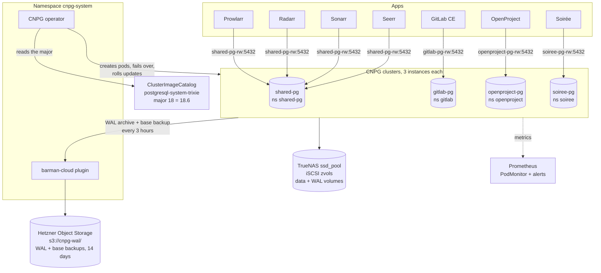
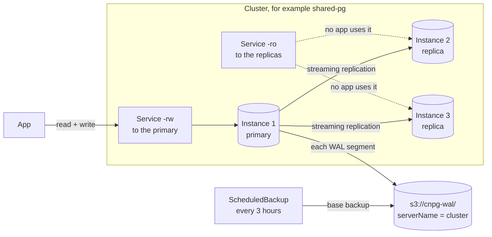

# Databases

This file describes the Postgres databases of the cluster. It covers the 4 CNPG clusters, the apps that use them, the storage, the backups, the monitoring and the upgrades. It also says how to add a database for a new app. Facts from the cluster were read on 2026-10-29.

## Documents

| Document | Read it when |
|---|---|
| [`README.md`](README.md) | You need the storage classes or the application inventory. |
| [`renovate.md`](renovate.md) | You want to know how the operator and the Postgres images get their updates. |
| [`monitoring.md`](monitoring.md) | You need the scrape path or the alert path. |
| [`../runbooks/restore-soiree-pg.md`](../runbooks/restore-soiree-pg.md) | You restore a cluster from the backup, or you rehearse it. |
| [`../runbooks/seerr-sonarr.md`](../runbooks/seerr-sonarr.md) | You work on Prowlarr, Radarr, Sonarr or Seerr. |
| [`../incidents/2026-10-29-cnpg-image-frozen-at-creation.md`](../incidents/2026-10-29-cnpg-image-frozen-at-creation.md) | You upgrade Postgres. |
| [`../incidents/2026-10-12-truenas-update-readonly-pv-remount.md`](../incidents/2026-10-12-truenas-update-readonly-pv-remount.md) | A Postgres volume turns read-only after a NAS update. |
| [`../incidents/2026-07-10-gitlab-backup-pg-dump-version.md`](../incidents/2026-07-10-gitlab-backup-pg-dump-version.md) | The GitLab backup cannot dump its database. |

## At a glance

| Item | Value |
|---|---|
| Operator | CloudNativePG (CNPG) 1.30.1, Application `cnpg-operator`, namespace `cnpg-system`. |
| Backup plugin | barman-cloud, Application `cnpg-plugin-barman-cloud`. |
| Clusters | 4: `shared-pg`, `gitlab-pg`, `openproject-pg`, `soiree-pg`. Each has 3 instances. |
| Postgres | Major 18, from the ClusterImageCatalog `postgresql-system-trixie`. Application `cnpg-catalog`. |
| Storage | `truenas-ssd-iscsi`: ext4 on a zvol of the SSD mirror, `sync=standard`. A separate volume for the WAL. |
| Backups | WAL archive all the time, and a base backup every 3 hours. Both go to `s3://cnpg-wal/` in Hetzner Object Storage. Retention is 14 days. |
| Monitoring | 1 PodMonitor per cluster, 12 alert rules in `manifests/monitoring/prometheusrule-cnpg.yaml`. |
| Connection pooler | None. |

## How the parts connect



## The clusters

| Cluster | Namespace | Data / WAL | Databases, size on 2026-10-29 | Used by |
|---|---|---|---|---|
| `shared-pg` | `shared-pg` | 10 Gi / 5 Gi | `prowlarr-main` 13 MB, `prowlarr-log` 9 MB, `radarr-main` 14 MB, `radarr-log` 9 MB, `sonarr-main` 19 MB, `sonarr-log` 9 MB, `seerr` 9 MB, `app` 8 MB | Prowlarr, Radarr, Sonarr, Seerr |
| `gitlab-pg` | `gitlab` | 20 Gi / 10 Gi | `gitlabhq_production` 152 MB | GitLab CE |
| `openproject-pg` | `openproject` | 10 Gi / 5 Gi | `openproject` 34 MB | OpenProject |
| `soiree-pg` | `soiree` | 10 Gi / 5 Gi | `soiree` 10 MB | Soirée |

- `shared-pg` holds the databases of small apps that do not need a cluster of their own. GitLab, OpenProject and Soirée each have their own cluster. A bad migration in 1 app then does not touch the others.
- The `app` database of `shared-pg` comes from `bootstrap.initdb`. No app uses it.
- All 4 clusters use the same parameters: `shared_buffers` 256MB, `work_mem` 16MB, `effective_cache_size` 1GB.
- CNPG spreads the 3 instances of a cluster over different nodes. On 2026-10-29 they ran on `talos-0wq-zph`, `talos-ako-s53` and `talos-3xg-mwx`.

## Inside 1 cluster



- The apps connect to the `-rw` Service. It always points to the primary. After a failover, CNPG moves it to the new primary.
- A replica streams the WAL from the primary. If the primary fails, CNPG promotes a replica.
- `primaryUpdateStrategy` is `unsupervised` and `primaryUpdateMethod` is `restart`. On an image change, CNPG updates the replicas first, then restarts the primary in place. Writes stop for a few seconds.
- Each cluster carries the annotation `Prune=false`. ArgoCD does not delete a cluster when its Application goes.

## Storage

The data and the WAL use `truenas-ssd-iscsi`. It is ext4 on a zvol of the SSD mirror, with `sync=standard`. Each commit gets a real `fsync` on the NAS. The file system and its locks stay on the node. Only the blocks go over the network.

WARNING: Do not put a database file on NFS. Sonarr and Radarr kept SQLite on NFS until 2026-10-29. SQLite took an NFS lock for each transaction, and both apps froze for 25 to 30 seconds at a time. Their liveness probe then restarted them.

NOTE: Postgres keeps a WAL segment until the archive confirms it. If the upload to the object storage fails, the WAL volume fills on all 3 instances. The cluster then stops accepting writes. A failing `ContinuousArchiving` condition is urgent.

## Backups and restore

| Item | Value |
|---|---|
| WAL archive | All the time, gzip, through the barman-cloud plugin. |
| Base backup | `ScheduledBackup` `<cluster>-3h`, schedule `0 0 */3 * * *`, method `plugin`. |
| Destination | `s3://cnpg-wal/` on `nbg1.your-objectstorage.com`. Each cluster uses its own `serverName`. |
| Retention | 14 days, in the `ObjectStore` of each cluster. |
| Point-in-time recovery | Any time in the last 14 days, within 1 major version. |
| Restore procedure | [`../runbooks/restore-soiree-pg.md`](../runbooks/restore-soiree-pg.md). The same steps apply to the other clusters. |

CAUTION: A point-in-time recovery cannot cross a major version. After a major upgrade, take a new base backup at once.

## Monitoring

Each cluster has a PodMonitor with the label `release: kube-prometheus-stack`. The rules are in `manifests/monitoring/prometheusrule-cnpg.yaml`:

| Alert | Fires when |
|---|---|
| `CNPGClusterNoReadyInstance` | No instance of a cluster is ready. |
| `CNPGClusterInstanceNotReady` | 1 instance is not ready. |
| `CNPGInstanceNotAnswering` | An instance does not answer the exporter. |
| `CNPGReplicationLagHigh` | A replica falls behind the primary. |
| `CNPGReplicaNotStreaming` | A replica does not stream the WAL. |
| `CNPGWalArchiveFailing` | The WAL archive fails. |
| `CNPGBackupFailed` | A base backup fails. |
| `CNPGBackupTooOld` | The last base backup is too old. |
| `CNPGInstanceFenced` | An instance is fenced. |
| `CNPGVolumeFillingUp` | A data or WAL volume fills up. |
| `CNPGVolumeAlmostFull` | A data or WAL volume is almost full. |
| `CNPGMetricsAbsent` | Prometheus gets no CNPG metrics. |

See the file for the exact thresholds.

## Upgrades

| What | How it moves | Effect |
|---|---|---|
| Operator | Renovate pull request for the chart `cloudnative-pg`, a person merges. | The operator restarts. It can also restart the pods of each cluster. |
| Postgres minor and image rebuild | Renovate pull request for the catalog, each Monday, a person merges. | Each cluster restarts once. |
| Postgres major | A person changes `imageCatalogRef.major` in 1 `cluster.yaml`. | An offline in-place upgrade with `pg_upgrade`. The cluster is down until it ends. |

The details and the steps for a major upgrade are in [`renovate.md`](renovate.md#postgres-and-cnpg) and in the incident [`2026-10-29-cnpg-image-frozen-at-creation.md`](../incidents/2026-10-29-cnpg-image-frozen-at-creation.md).

## How to add a database to shared-pg

This is how Prowlarr, Radarr, Sonarr and Seerr got their databases. Use `myapp` for the name of the app.

1. Generate a password. Keep it out of git and out of logs.
2. Create `manifests/shared-pg/role-myapp.enc.yaml`. It is a Secret of type `kubernetes.io/basic-auth` with the name `shared-pg-role-myapp`, the label `cnpg.io/reload: "true"`, the `username` `myapp` and the password.
3. Encrypt the file with SOPS.
4. Add the file to `manifests/shared-pg/secret-generator.yaml`.
5. Add the role to `spec.managed.roles` in `manifests/shared-pg/cluster.yaml`. Set `ensure: present`, `login: true` and `passwordSecret.name: shared-pg-role-myapp`.
6. Add a `Database` to `manifests/shared-pg/databases.yaml`. Set `owner: myapp` and `databaseReclaimPolicy: retain`.
7. Merge the change. CNPG creates the role and the database.
8. In the namespace of the app, add a SOPS Secret with the same password.
9. Point the app to `shared-pg-rw.shared-pg.svc.cluster.local`, port `5432`.

Expected result: `kubectl -n shared-pg get database` shows the new database with `APPLIED` `true`.

NOTE: `databaseReclaimPolicy: retain` keeps the database in Postgres when the `Database` resource goes. Drop it by hand if you really want it gone.

## How the Servarr apps moved from SQLite

On 2026-10-28 and 2026-10-29, Prowlarr, Radarr, Sonarr and Seerr moved from SQLite on NFS to `shared-pg`. Each app was moved in the same way:

1. A second process of the app, with a temporary data folder and another port, ran its own migrations against the empty databases. This made the schema of the right version.
2. A copy of the SQLite file passed `pragma integrity_check`.
3. A script copied each table in 1 transaction per database. It compared the row counts and rolled back on a mismatch.
4. A pull request set the database variables of the app.

The old SQLite files stay on the volume of each app as a fallback. To go back, remove the database variables from the Deployment.

## How to check

1. Check the state of each cluster:

   ```sh
   kubectl get clusters.postgresql.cnpg.io -A
   ```

   Expected result: each cluster shows `Cluster in healthy state` and 3 ready instances.

2. Check the WAL archive of a cluster:

   ```sh
   kubectl -n shared-pg get cluster shared-pg -o jsonpath='{.status.conditions[?(@.type=="ContinuousArchiving")].status}'
   ```

   Expected result: `True`.

3. Check the last base backups:

   ```sh
   kubectl -n shared-pg get backup --sort-by=.metadata.creationTimestamp
   ```

4. Check the image of each cluster:

   ```sh
   kubectl get clusters.postgresql.cnpg.io -A -o custom-columns=NAME:.metadata.name,IMAGE:.status.image
   ```

5. List the databases of `shared-pg`:

   ```sh
   kubectl -n shared-pg get database
   ```
