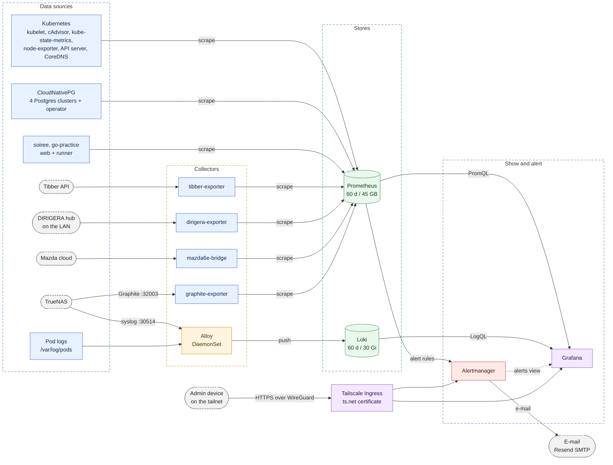
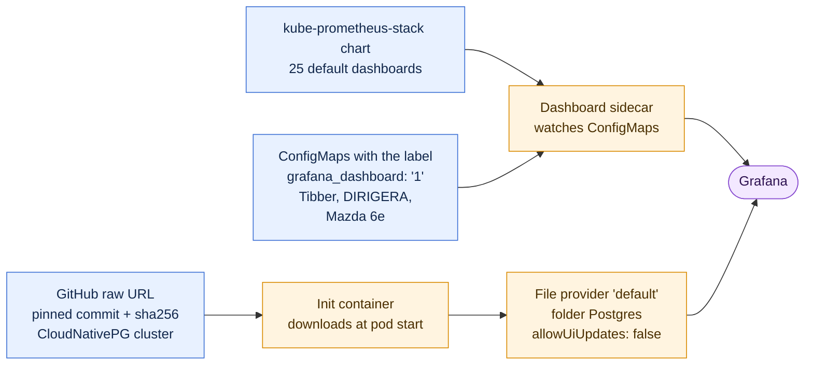
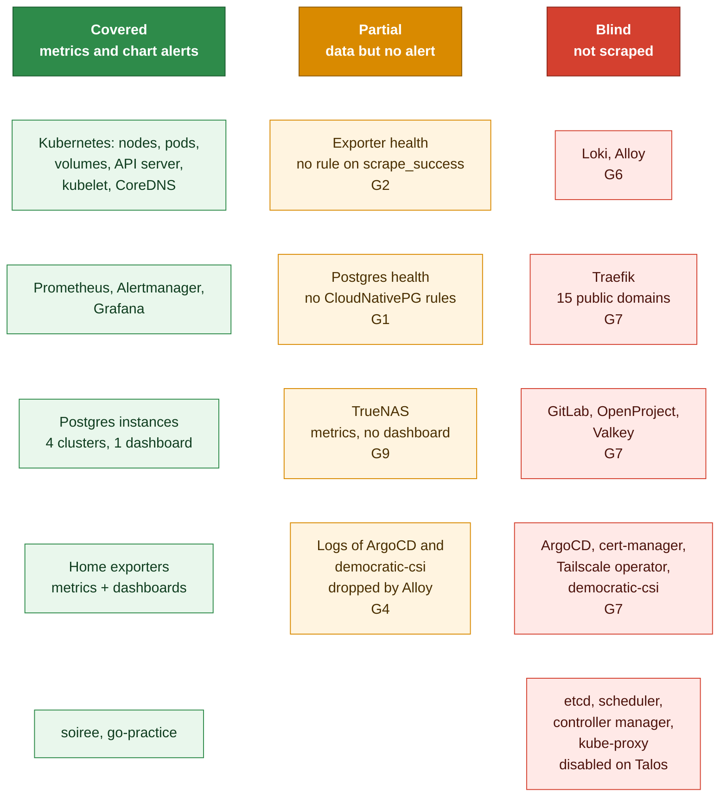

# Monitoring

This file describes how the cluster is monitored. It covers metrics, logs, dashboards and alerts. It lists the gaps that exist today. Read it before you change anything in the `monitoring` namespace.

## Documents

| Document | Read it when |
|---|---|
| [`README.md`](README.md) | You need the storage classes or the application inventory. |
| [`../runbooks/tailnet-only-admin-uis.md`](../runbooks/tailnet-only-admin-uis.md) | You need to reach Grafana or Alertmanager, or you change their tailnet address. |
| [`../runbooks/mazda6e-bridge.md`](../runbooks/mazda6e-bridge.md) | You activate the Mazda exporter or replace its credentials. |
| [`../incidents/grafana-rwo-multi-attach.md`](../incidents/grafana-rwo-multi-attach.md) | You change the rollout strategy of Grafana. |
| [`../incidents/2026-09-09-prometheus-release-label-selector.md`](../incidents/2026-09-09-prometheus-release-label-selector.md) | A monitor or a rule does not appear in Prometheus. |
| [`../incidents/2026-07-10-loki-chunks-cache-oversized.md`](../incidents/2026-07-10-loki-chunks-cache-oversized.md) | You change a Loki cache. |
| [`../incidents/2026-10-12-truenas-update-readonly-pv-remount.md`](../incidents/2026-10-12-truenas-update-readonly-pv-remount.md) and [`../incidents/2026-10-13-readonly-alert-cleared-while-volume-broken.md`](../incidents/2026-10-13-readonly-alert-cleared-while-volume-broken.md) | You change the storage alert. |
| [`Yornik/dirigera-exporter`](https://github.com/Yornik/dirigera-exporter) | You change the DIRIGERA exporter. |
| [`Yornik/mazda6e-grafana-bridge`](https://github.com/Yornik/mazda6e-grafana-bridge) | You change the Mazda exporter or its dashboard. |

## At a glance

| Item | Value |
|---|---|
| Applications | 8: `kube-prometheus-stack`, `loki`, `alloy`, `monitoring`, `truenas-monitoring`, `tibber-exporter`, `dirigera-exporter`, `mazda6e-bridge`. |
| Namespace | `monitoring`, with Pod Security level `privileged`. |
| Metrics | Prometheus, 1 replica. Retention is 60 days or 45 GB, on a 50 Gi volume. |
| Logs | Alloy on each node, then Loki. Loki keeps 60 days on a 30 Gi volume. |
| Dashboards | Grafana. 25 from the chart, 1 for Postgres, 3 in this repository. |
| Alerts | Prometheus rules, then Alertmanager, then e-mail through Resend SMTP. |
| Access | Tailnet only. Grafana and Alertmanager have a Tailscale Ingress. Prometheus has no address outside the cluster. |
| Storage | All 4 stateful components use the `truenas-ssd` class. They store their data on the NAS that they monitor. |

## Overview



## Components

| Component | Application | Role | Data volume |
|---|---|---|---|
| Prometheus | `kube-prometheus-stack` | Scrapes targets, evaluates rules, stores metrics. The Prometheus Operator runs it. | 50 Gi, `truenas-ssd` |
| Alertmanager | `kube-prometheus-stack` | Groups alerts and sends the e-mail. 1 replica. | 2 Gi, `truenas-ssd` |
| Grafana | `kube-prometheus-stack` | Dashboards and Explore. 2 sidecar containers load dashboards and data sources from ConfigMaps. | 2 Gi, `truenas-ssd` |
| kube-state-metrics, node-exporter | `kube-prometheus-stack` | Cluster object state and node hardware. node-exporter runs without the systemd collector, because Talos has no systemd. | none |
| Loki | `loki` | Stores logs. `SingleBinary` mode, 1 replica, filesystem store. | 30 Gi, `truenas-ssd` |
| Alloy | `alloy` | Reads the log file of each pod on its node. Receives syslog from the NAS. Runs on every node, control plane included. | none |
| graphite-exporter | `truenas-monitoring` | Turns the Graphite stream of the NAS into Prometheus metrics. | none |
| Home exporters | `tibber-exporter`, `dirigera-exporter`, `mazda6e-bridge` | See [Home exporters](#home-exporters). | none |

NOTE: Four components keep their data on the NAS that they monitor. If the NAS stops, metrics, logs and alert delivery stop together. See gap G3.

## Metrics

### What Prometheus scrapes

The chart creates 9 ServiceMonitors: Alertmanager, API server, CoreDNS, kubelet, the Prometheus Operator, Prometheus, Grafana, kube-state-metrics and node-exporter. This repository adds these:

| Target | Object | Interval | File |
|---|---|---|---|
| tibber-exporter | ServiceMonitor | 30 s | `manifests/tibber-exporter/servicemonitor.yaml` |
| dirigera-exporter | ServiceMonitor | 30 s | `manifests/dirigera-exporter/servicemonitor.yaml` |
| mazda6e-bridge | ServiceMonitor | 60 s | `manifests/mazda6e-bridge/servicemonitor.yaml` |
| graphite-exporter | ServiceMonitor | 30 s | `manifests/truenas-monitoring/servicemonitor.yaml` |
| soiree | ServiceMonitor | 30 s | `manifests/soiree/servicemonitor.yaml` |
| go-practice web | ServiceMonitor | 30 s | `manifests/go-practice/servicemonitor-web.yaml` |
| go-practice runner | ServiceMonitor | 30 s | `manifests/go-practice/servicemonitor-runner.yaml` |
| Postgres `shared-pg` | PodMonitor | default | `manifests/shared-pg/podmonitor.yaml` |
| Postgres `openproject-pg` | PodMonitor | default | `manifests/openproject/podmonitor.yaml` |
| Postgres `gitlab-pg` | PodMonitor | default | `manifests/gitlab/podmonitor.yaml` |
| Postgres `soiree-pg` | PodMonitor | default | `manifests/soiree/podmonitor.yaml` |
| CloudNativePG operator | PodMonitor | default | created by the `cnpg-operator` chart |

The 4 Postgres PodMonitors drop 3 backup metrics that are always 0. The barman plugin exports the real values under other names. The `Cluster` objects set `enablePodMonitor: false`, so that these PodMonitors carry the label that Prometheus needs.

The cluster disables the scrape of etcd, the scheduler, the controller manager and kube-proxy. Talos does not expose them to Omni. No alert covers these 4 components.

### How a monitor becomes visible

CAUTION: Prometheus ignores a ServiceMonitor, PodMonitor or PrometheusRule without the label `release: kube-prometheus-stack`. There is no error. See [the incident](../incidents/2026-09-09-prometheus-release-label-selector.md).

To list the monitors that Prometheus ignores, run:

```bash
kubectl --context yornik-sharkshere get servicemonitors,podmonitors,prometheusrules -A \
  -o custom-columns='NS:.metadata.namespace,NAME:.metadata.name,RELEASE:.metadata.labels.release'
```

A row with an empty RELEASE column is invisible to Prometheus.

### Push paths from the NAS

The NAS pushes to 2 NodePort Services. Neither has authentication.

| Stream | Port | Receiver | Result |
|---|---|---|---|
| Graphite | TCP 32003 | `graphite-exporter` | Prometheus metrics. The mapping file renames the metrics and sets the label `job="truenas"`. |
| Syslog | TCP and UDP 30514 | Alloy, port 5140 | Loki logs with `job="truenas"` and `instance="nas"`. |

NOTE: Prometheus keeps its own `job` label, `graphite-exporter`, and renames the mapped label to `exported_job`. On 2026-10-23 there were 551 series with `exported_job="truenas"` and none with `job="truenas"`. Query `exported_job`.

### Recording rules

The group `downsample_5m` records 6 series every 5 minutes. No dashboard in this repository queries them.

| Series | Meaning |
|---|---|
| `job:node_cpu_utilisation:avg5m` | CPU use of a node. |
| `job:node_memory_utilisation:avg5m` | Memory use of a node. |
| `job:node_network_receive_bytes:rate5m` | Receive rate of a node, without virtual interfaces. |
| `job:node_network_transmit_bytes:rate5m` | Transmit rate of a node, without virtual interfaces. |
| `namespace:container_cpu_usage:rate5m` | CPU use of a namespace. |
| `namespace:container_memory_working_set:avg5m` | Memory use of a namespace. |

## Home exporters

Three exporters turn a home data source into metrics. Each image comes from its own repository and CI. This repository holds the manifests and the dashboard copy. This section is based on the source code of the DIRIGERA and Mazda repositories, read on 2026-10-23.

| Item | DIRIGERA exporter | Mazda 6e bridge |
|---|---|---|
| Source | [`Yornik/dirigera-exporter`](https://github.com/Yornik/dirigera-exporter) | [`Yornik/mazda6e-grafana-bridge`](https://github.com/Yornik/mazda6e-grafana-bridge) |
| Language | Python, `prometheus_client`, the `dirigera` library | Python, `prometheus_client` |
| Data source | The local HTTPS API of the IKEA hub. The hub uses a self-signed certificate, so the library skips verification. | The Mazda cloud API, Europe backend only. |
| Poll interval | 30 s | 120 s. The code refuses a value below 60 s. |
| Scrape interval | 30 s | 60 s |
| Credential | Hub token in the Secret `dirigera-api` | E-mail, password and device ID in the Secret `mazda6e-api` |
| Metric prefix | `ikea_` | `mazda6e_` |
| Health metrics | `ikea_dirigera_scrape_success`, `ikea_dirigera_last_success_timestamp_seconds` | `mazda6e_scrape_success`, `mazda6e_vehicle_scrape_success`, `mazda6e_last_success_timestamp_seconds` |
| After a failed poll | Sets the success metric to 0. The other gauges keep their last value. | Sets the success metric to 0. The other gauges keep their last value. After a refused login it waits 1 hour. |
| Health on the dashboard | No panel | The row `Exporter` |
| Rollout | Default `RollingUpdate` | `Recreate`, so that 1 session logs in with the device ID |
| CI in the source repository | ruff, pytest, image build | ruff, actionlint, hadolint, a read-only guard, pytest, `promtool` on every dashboard query, `pip-audit`, an image smoke test |

Both Deployments run as user 65532, with a read-only root file system, no capabilities and a 128 Mi memory limit. Neither has a CPU limit.

WARNING: The Mazda Secret is a full login to the Mazda account. The bridge only reads, and its CI enforces that. Another program with the same 3 values can control the car. See [`../runbooks/mazda6e-bridge.md`](../runbooks/mazda6e-bridge.md).

NOTE: `up` stays 1 for both exporters when the hub or the Mazda cloud fails. The exporter still answers `/metrics`. Only the `*_scrape_success` metrics show the failure. See gap G2.

NOTE: The Tibber exporter is a fork of `terjesannum/tibber-exporter` with 15-minute prices. Alloy drops its live-measurement and price-update log lines. The process exits with code 1 when its live subscription drops, and Kubernetes starts it again. On 2026-10-23 at 10:54 UTC a timeout did this, and the pod showed 2 restarts after 2 days.

## Logs

### Collection

Alloy runs as a DaemonSet with a toleration for every taint. Each pod reads only the pods on its own node.

1. `discovery.kubernetes` lists the pods on the node.
2. `discovery.relabel` drops the `loki-canary` pods. It sets the labels `namespace`, `pod`, `container` and `app`, and the path of the log files.
3. `loki.source.file` tails the files.
4. `loki.process` parses the CRI format, drops noise, finds the log level and sets the `level` label.
5. `loki.write` pushes to `http://loki.monitoring.svc:3100`.

The `app` label comes from the pod label `app`, or from `app.kubernetes.io/name` if that exists.

### What the pipeline drops

| Selector | Dropped | Reason |
|---|---|---|
| All pods | Lease renewals and readiness probe access lines. | Heartbeat noise. |
| All pods | Lines longer than 16 KB. | Protects Loki from one huge line. |
| `tibber-exporter` | Live measurements and price-update lines. | One line for each reading. |
| `democratic-csi` | `NodeGetVolumeStats` and request header lines. | Noise. |
| `traefik` | Probe requests in the access log. | Noise. |
| `grafana` | Its own Loki query lines. | Querying logs would create more logs. |
| `external-dns` | Webhook access lines. | They stay in the pod log. |
| `loki` | Its own query statistics. | Same loop as Grafana. |
| `job="truenas"` | Systemd session lines and notify messages. | The SSH lines carry the audit signal. |
| app `democratic-csi`, namespace `argocd` | Every line. The 2 stages intend to drop only lines below `warn`. | Volume. This is a fault: see gap G4. |

The log level comes from the JSON fields `level`, `severity` and `log_level`, or from a keyword in the line. A line on `stderr` without a level becomes `error`. A line on `stdout` without a level becomes `info`.

### Loki

| Setting | Value | Reason |
|---|---|---|
| Mode | `SingleBinary`, 1 replica, filesystem store. | One small cluster. |
| Retention | 1440 h (60 days), compactor on. | Same as the metrics. |
| Authentication | Off. | Only Grafana and Alloy reach it. |
| Chunks cache | Off. | Measured 0.3 % hit rate. See [the incident](../incidents/2026-07-10-loki-chunks-cache-oversized.md). |
| Results cache | 256 MB. | Grafana repeats range queries. |
| Log level | `error`. | Quiet pod log. |

Loki has no ruler. No alert is based on a log line.

## Grafana

### Access

Grafana is reachable on the tailnet only, at `https://grafana.hedgehog-wage.ts.net`. A Tailscale Ingress terminates TLS. The Ingress skips Traefik, so no fail2ban or rate limit applies. The login is the only gate. The values configure the local admin account from the SOPS Secret `grafana-admin`, and no other login method.

The Deployment uses `maxSurge: 0`, because the volume is ReadWriteOnce. See [the incident](../incidents/grafana-rwo-multi-attach.md).

### Data sources

| Name | Type | Source | Note |
|---|---|---|---|
| Prometheus | prometheus | Chart | Default. Queries use POST. Time interval 30 s. |
| Alertmanager | alertmanager | Chart | `handleGrafanaManagedAlerts: false`. Grafana shows Prometheus alerts only. |
| Loki | loki | `manifests/monitoring/grafana-datasource-loki.yaml` | Not the default. Limit of 1000 lines. |

NOTE: Grafana also has a data source type `grafana-amazonprometheus-datasource`. With no selection, a dashboard can pick it before `Prometheus`, and every panel shows "No data". Pin the data source variable to `Prometheus` in each dashboard.

### Dashboards



| Dashboard | Source of truth | Note |
|---|---|---|
| 25 chart dashboards | The chart | Kubernetes, node and Prometheus views. Rendered 2026-10-23 from chart 92.11.0. |
| CloudNativePG cluster | `cloudnative-pg/grafana-dashboards`, pinned by commit and `sha256` | Renovate tracks the commit. The operator chart dashboard is off, because it queries deprecated metrics. |
| Tibber | `manifests/tibber-exporter/grafana-dashboard.yaml` | UID `5rT8QDiVk`. |
| DIRIGERA Air Quality | `manifests/dirigera-exporter/grafana-dashboard.yaml` | UID `dirigera-air`. Refresh 30 s, range 24 h. |
| Mazda 6e | The source repository, `dashboards/mazda6e.json` | UID `mazda6e-bridge`. Refresh 5 m, range 7 days. This copy differs from the source in places that the file header lists. |

Make each change to the Mazda dashboard in the source repository first. The source CI parses every query with `promtool`. CI in this repository does not parse dashboard queries.

A dashboard that you build in the Grafana UI exists only on the Grafana volume. Git does not hold it.

## Alerts

The path is: Prometheus rule, Alertmanager, e-mail through Resend SMTP. The Alertmanager configuration is a SOPS Secret, `manifests/monitoring/alertmanager-config.enc.yaml`, so git cannot show it. The table below comes from the running Alertmanager, read on 2026-10-23, with secrets left out.

| Setting | Value |
|---|---|
| Default receiver | `email`. This is the only receiver type. |
| `Watchdog` and `InfoInhibitor` | Receiver `null`. Nothing receives them. |
| Grouping | By `alertname` and `namespace`. |
| Timing | Group wait 30 s, group interval 5 m, repeat interval 12 h. |
| High availability | None. 1 replica, cluster status `disabled`. |

The chart inhibit rules let a critical alert hide a warning or an info alert with the same `alertname` and `namespace`.

Rendered on 2026-10-23, the chart gives 134 alerts in 30 rule objects. This repository adds 1 alert. The chart rules for etcd, the scheduler, the controller manager and kube-proxy are absent, because those components are disabled.

| Alert | Source | Fires when |
|---|---|---|
| `TargetDown` | Chart | More than 10 % of the targets of a Service are down for 10 minutes. |
| `KubePodCrashLooping` | Chart | A container is in `CrashLoopBackOff` for 15 minutes. |
| `KubeJobFailed` | Chart | A Job failed, for 15 minutes. |
| `KubePersistentVolumeFillingUp` | Chart | A volume has less than 15 % free, with more checks. |
| `CPUThrottlingHigh` | Chart | A container is throttled. Severity `info`. |
| `Watchdog` | Chart | Always. It proves that the rule engine works. |
| `VolumeRemountedReadOnly` | `apps/values.yaml` | A CSI volume turned read-only. Critical. Holds for 24 hours. See [the incident](../incidents/2026-10-13-readonly-alert-cleared-while-volume-broken.md). |

CAUTION: Alertmanager has no login. A tailnet device can silence every alert. See [`../runbooks/tailnet-only-admin-uis.md`](../runbooks/tailnet-only-admin-uis.md).

## Coverage



## Gaps

Each gap has evidence. A gap is not a fault. It is a place where a failure produces no signal today, or where a signal is lost. "Live" means a read-only query of the running cluster on 2026-10-23.

| ID | Priority | Gap | Evidence | Suggested correction |
|---|---|---|---|---|
| G1 | High | No alert rule exists for the 4 Postgres clusters. Replication lag, WAL archive failure and backup failure raise nothing. | `apps/values.yaml` sets `monitoring.prometheusRule.enabled: true` for `cnpg-operator`. Chart 0.29.1 has no such key. Live: 135 alerting rules in 32 objects, none for CloudNativePG. | Add a PrometheusRule with the label `release: kube-prometheus-stack`. Remove the dead key. |
| G2 | High | A failure of the hub or the Mazda cloud raises no alert. | `up` stays 1. No rule uses `ikea_dirigera_scrape_success` or `mazda6e_scrape_success`. Live: both read 1 today, so a failure would be silent. | Alert on both metrics at 0 for 15 minutes. Use a longer period for Mazda, because it waits 1 hour after a refused login. |
| G3 | High | The monitoring stack stores its data on the NAS that it monitors. Nothing outside the cluster notices that the stack is down. | All 4 volumes use `truenas-ssd`. Live: the running Alertmanager sends `Watchdog` to the receiver `null`, and e-mail is its only receiver type. | Send `Watchdog` to an external heartbeat service that alerts when the signal stops. |
| G4 | High | The logs of ArgoCD and democratic-csi are missing from Loki. The 2 drop stages remove every line, not only the lines below `warn`. | Live: Loki holds 0 lines for `{namespace="argocd"}` and for `{namespace="democratic-csi"}` over 7 days. 14 ArgoCD pods run. The democratic-csi NFS node pods show 11 to 20 restarts and have no log to read. In `apps/values.yaml` the `level` label is set by `stage.labels` after the 2 `stage.match` stages that select on it. A selector sees labels only, not extracted values. | Drop on the extracted value inside a `stage.match` for the namespace, with `stage.drop` and `source = "level"`. Or move `stage.labels` before the 2 stages. Test with `{namespace="argocd"}` in Explore. |
| G5 | Medium | Prometheus will trim by size before the 60 days end. | Live: the blocks hold 42.3 GiB against a limit of 45 GiB. The oldest data is 52 days old. At about 0.8 GiB for each day, the limit is reached at about 55 days. The volume holds 29.2 GiB of 50 GiB, because the NAS compresses. | Raise `retentionSize`, or lower `retention` to match. Check the growth first. |
| G6 | Medium | Alloy and Loki are not scraped. A stopped log shipper on one node raises nothing while its pod stays Ready. | The charts render no ServiceMonitor. The keys `serviceMonitor.enabled` (Alloy) and `monitoring.serviceMonitor.enabled` (Loki) are `false` by default. Live: Prometheus has no target for either. | Enable both, with `additionalLabels` set to `release: kube-prometheus-stack`. |
| G7 | Medium | Traefik, GitLab, OpenProject, Valkey, ArgoCD, cert-manager, the Tailscale operator and democratic-csi have no monitor. | Rendering every Helm app found 1 monitor, the CloudNativePG PodMonitor. `bootstrap/argocd/install.yaml` has none. Live: 49 targets, none for these. | Start with Traefik, which serves the 15 public domains. |
| G8 | Medium | The comment in `apps/values.yaml` says that Prometheus scrapes the GitLab pods through a PodMonitor. No such PodMonitor exists. | Only `manifests/gitlab/podmonitor.yaml` exists, and it selects the Postgres pods. | Correct the comment, or add the PodMonitors. |
| G9 | Low | The TrueNAS metrics have no dashboard in git, and the label differs from the mapping file. | Live: 551 series and 113 metric names with `exported_job="truenas"`. No ConfigMap dashboard mentions TrueNAS. | Add a dashboard that queries `exported_job`. Or confirm that one lives in the UI only. |
| G10 | Low | The DIRIGERA dashboard shows the last value for ever when the hub fails. | The exporter keeps the old gauges. The dashboard has no health panel. | Add a panel for `ikea_dirigera_scrape_success`, as the Mazda dashboard has. |
| G11 | Low | The comment in the DIRIGERA Deployment blames Go and `GOMAXPROCS` for the CPU throttling. The exporter is Python. | `dirigera_exporter.py` uses `prometheus_client`. The Dockerfile uses `python:3.15-slim`. | Correct the cause in the comment. The measurement stays valid. |
| G12 | Low | CI does not parse dashboard queries. A typo shows as an empty panel. | `.github/workflows/validate.yaml` has no `promtool` step. | Run the `promtool` check from the Mazda repository over `manifests/*/grafana-dashboard.yaml`. |

## Procedures

### How to check that Prometheus scrapes a target

1. Open a tunnel to Prometheus:

   ```bash
   kubectl --context yornik-sharkshere -n monitoring port-forward svc/kube-prometheus-stack-prometheus 9090:9090
   ```

2. Open `http://localhost:9090/targets`.
3. Find the target by job name.

Expected result: the state is `UP`. If the target is missing, check the `release` label. See [How a monitor becomes visible](#how-a-monitor-becomes-visible).

### How to add a scrape target

1. Create a ServiceMonitor in the directory of the application. Select the Service by label.
2. Set the label `release: kube-prometheus-stack` in `metadata.labels`.
3. Name the port of the Service, not the number.
4. Add the file to `kustomization.yaml`.
5. Run the checks in [`AGENTS.md`](../../AGENTS.md).
6. Merge the pull request.
7. Check the target as described above.

### How to add a dashboard

1. Build the dashboard in Grafana and export the JSON.
2. Set a fixed `uid`.
3. Add a data source variable of type `prometheus` and select `Prometheus` as the current value.
4. Put the JSON in a ConfigMap in the namespace `monitoring`. Set the label `grafana_dashboard: '1'`.
5. Add the file to `kustomization.yaml`.
6. Merge the pull request.

Expected result: the sidecar loads the dashboard. A restart of Grafana is not needed.

### How to add an alert rule

1. Test the expression in the Prometheus UI.
2. Add a group to `additionalPrometheusRulesMap` in `apps/values.yaml`. Or add a PrometheusRule with the label `release: kube-prometheus-stack`.
3. Set `for:` and a `severity` label.
4. Add a comment that gives the reason for each value that is not obvious.
5. Run the checks in [`AGENTS.md`](../../AGENTS.md).
6. Merge the pull request.

Expected result: the rule appears on `/rules` in Prometheus.

## Evidence

- Chart facts come from `helm template` of `kube-prometheus-stack` 92.11.0, `loki` 7.5.0 and `alloy` 1.14.3 with the inline values of `apps/values.yaml`, run on 2026-10-23. Every other Helm app was rendered the same way to count its monitors.
- Exporter facts come from the source of `Yornik/dirigera-exporter` at tag `v0.3.0` and `Yornik/mazda6e-grafana-bridge`, read on 2026-10-23.
- Cluster facts come from read-only queries on 2026-10-23, through the Omni Kubernetes endpoint. The queries read Prometheus targets, rules and alerts, Loki counts, the Alertmanager status, and pod and ArgoCD state. 49 targets were up, 174 pods were Running or Succeeded, and 55 ArgoCD Applications existed.
- The Alertmanager configuration is a SOPS Secret. The routes in this file come from the running Alertmanager, with secrets left out.
