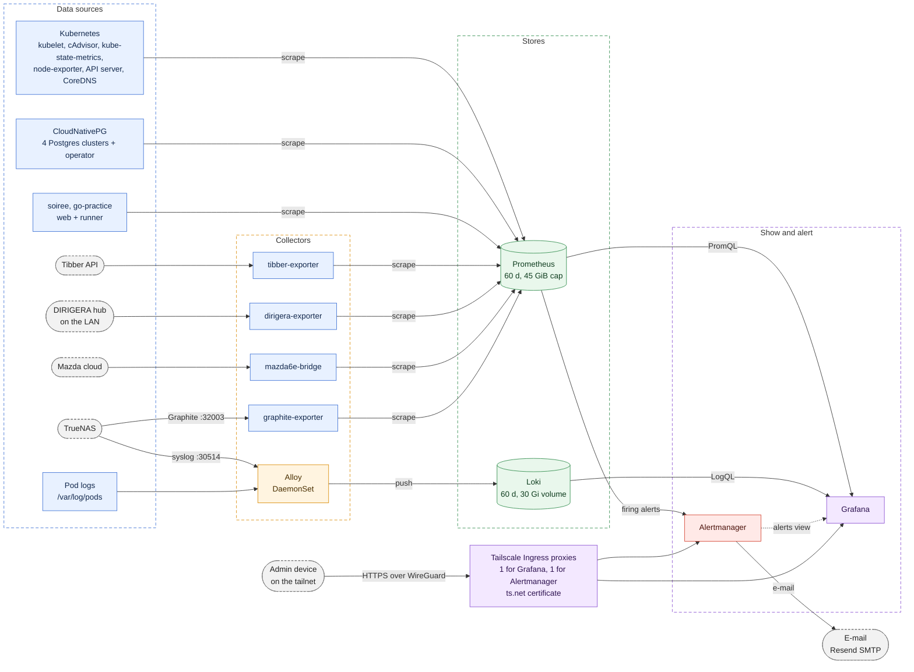
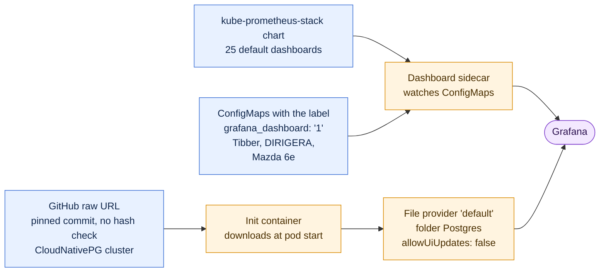
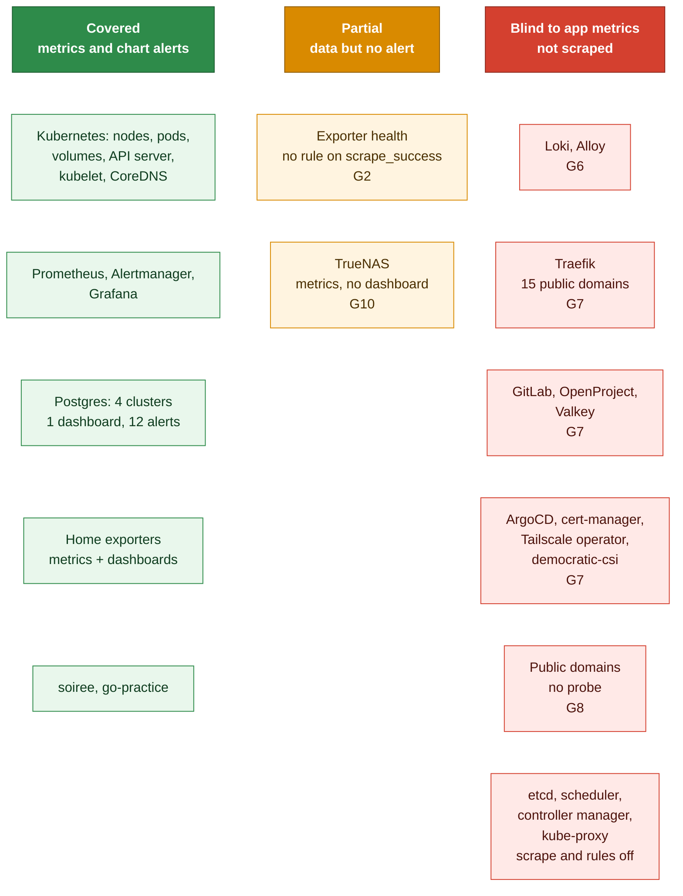

# Monitoring

This file describes how the cluster is monitored. It covers metrics, logs, dashboards and alerts. It lists the gaps that exist today. Read it before you change anything in the `monitoring` namespace. Counts of chart objects and facts from the cluster were read on 2026-10-23, and they change with each chart bump.

## Documents

| Document | Read it when |
|---|---|
| [`README.md`](README.md) | You need the storage classes or the application inventory. |
| [`../runbooks/tailnet-only-admin-uis.md`](../runbooks/tailnet-only-admin-uis.md) | You need to reach Grafana or Alertmanager, or you change their tailnet address. |
| [`../runbooks/mazda6e-bridge.md`](../runbooks/mazda6e-bridge.md) | You activate the Mazda exporter or replace its credentials. |
| [`../incidents/grafana-rwo-multi-attach.md`](../incidents/grafana-rwo-multi-attach.md) | You change the rollout strategy of Grafana. |
| [`../incidents/2026-09-09-prometheus-release-label-selector.md`](../incidents/2026-09-09-prometheus-release-label-selector.md) | A monitor or a rule does not appear in Prometheus. |
| [`../incidents/2026-07-10-loki-chunks-cache-oversized.md`](../incidents/2026-07-10-loki-chunks-cache-oversized.md) | You change a Loki cache. |
| [`../incidents/2026-10-12-truenas-update-readonly-pv-remount.md`](../incidents/2026-10-12-truenas-update-readonly-pv-remount.md) and [`../incidents/2026-10-13-readonly-alert-cleared-while-volume-broken.md`](../incidents/2026-10-13-readonly-alert-cleared-while-volume-broken.md) | You change the storage alert. |
| [`../incidents/2026-10-11-backup-prune-transient-delete-504.md`](../incidents/2026-10-11-backup-prune-transient-delete-504.md) and [`../incidents/2026-10-21-gitlab-backup-object-storage-504.md`](../incidents/2026-10-21-gitlab-backup-object-storage-504.md) | You get a `KubeJobFailed` e-mail. |
| [`Yornik/dirigera-exporter`](https://github.com/Yornik/dirigera-exporter) | You change the DIRIGERA exporter. |
| [`Yornik/mazda6e-grafana-bridge`](https://github.com/Yornik/mazda6e-grafana-bridge) | You change the Mazda exporter or its dashboard. |
| [`Yornik/tibber-exporter`](https://github.com/Yornik/tibber-exporter) | You change the Tibber exporter. |

## At a glance

| Item | Value |
|---|---|
| Applications | 8: `kube-prometheus-stack`, `loki`, `alloy`, `monitoring`, `truenas-monitoring`, `tibber-exporter`, `dirigera-exporter`, `mazda6e-bridge`. |
| Namespace | `monitoring`, with Pod Security level `privileged`. |
| Metrics | Prometheus, 1 replica. Retention is 60 days or 45 GiB, on a 50 Gi volume. |
| Logs | Alloy on each node, then Loki. Loki keeps 60 days on a 30 Gi volume. |
| Dashboards | Grafana. 25 from the chart, 1 for Postgres, 3 in this repository. |
| Alerts | Prometheus rules, then Alertmanager, then e-mail through Resend SMTP. |
| Access | The web interfaces are on the tailnet only. Grafana and Alertmanager each have a Tailscale Ingress. Prometheus has no address outside the cluster. The 2 NAS push ports are NodePorts without authentication. |
| Storage | All 4 stateful components use the `truenas-ssd` class. They store their data on the NAS that they monitor. |

## Overview



## Components

| Component | Application | Role | Data volume |
|---|---|---|---|
| Prometheus | `kube-prometheus-stack` | Scrapes targets, evaluates rules, stores metrics. The Prometheus Operator runs it. | 50 Gi, `truenas-ssd` |
| Alertmanager | `kube-prometheus-stack` | Groups alerts and sends the e-mail. 1 replica. | 2 Gi, `truenas-ssd` |
| Grafana | `kube-prometheus-stack` | Dashboards and Explore. 2 sidecar containers load dashboards and data sources from ConfigMaps. | 2 Gi, `truenas-ssd` |
| kube-state-metrics, node-exporter | `kube-prometheus-stack` | Cluster object state and node hardware. Talos has no systemd. The flag `--no-collector.systemd` repeats the default of node-exporter. | none |
| Loki | `loki` | Stores logs. `SingleBinary` mode, 1 replica, filesystem store. | 30 Gi, `truenas-ssd` |
| Alloy | `alloy` | Reads the log file of each pod on its node. Receives syslog from the NAS. Runs as a DaemonSet on every schedulable node. | none |
| graphite-exporter | `truenas-monitoring` | Turns the Graphite stream of the NAS into Prometheus metrics. | none |
| Home exporters | `tibber-exporter`, `dirigera-exporter`, `mazda6e-bridge` | See [Home exporters](#home-exporters). | none |

NOTE: Four components keep their data on the NAS that they monitor. If the NAS stops, the volumes of all 4 stop together. See gap G3.

The values set no resource requests or limits for Prometheus, Alertmanager, Grafana and Loki. Alloy has requests of 50m CPU and 128 Mi, and limits of 250m CPU and 256 Mi.

## Metrics

### What Prometheus scrapes

The chart creates 9 ServiceMonitors: Alertmanager, API server, CoreDNS, kubelet, the Prometheus Operator, Prometheus, Grafana, kube-state-metrics and node-exporter. This repository adds these:

| Target | Object | Interval | File |
|---|---|---|---|
| tibber-exporter | ServiceMonitor | 30 s | `manifests/tibber-exporter/servicemonitor.yaml` |
| dirigera-exporter | ServiceMonitor | 30 s | `manifests/dirigera-exporter/servicemonitor.yaml` |
| mazda6e-bridge | ServiceMonitor | 60 s | `manifests/mazda6e-bridge/servicemonitor.yaml` |
| graphite-exporter | ServiceMonitor | 30 s | `manifests/truenas-monitoring/servicemonitor.yaml` |
| soiree | ServiceMonitor | 30 s | `manifests/soiree/servicemonitor.yaml` |
| go-practice web | ServiceMonitor | 30 s | `manifests/go-practice/servicemonitor-web.yaml` |
| go-practice runner | ServiceMonitor | 30 s | `manifests/go-practice/servicemonitor-runner.yaml` |
| Postgres `shared-pg` | PodMonitor | default | `manifests/shared-pg/podmonitor.yaml` |
| Postgres `openproject-pg` | PodMonitor | default | `manifests/openproject/podmonitor.yaml` |
| Postgres `gitlab-pg` | PodMonitor | default | `manifests/gitlab/podmonitor.yaml` |
| Postgres `soiree-pg` | PodMonitor | default | `manifests/soiree/podmonitor.yaml` |
| CloudNativePG operator | PodMonitor | default | created by the `cnpg-operator` chart |

The 4 Postgres PodMonitors drop 3 backup metrics that are always 0. The barman plugin exports the real values under other names. The `Cluster` objects set `enablePodMonitor: false`, so the operator creates no PodMonitor of its own. This repository ships its own PodMonitors, which carry the `release` label.

The cluster disables the scrape of etcd, the scheduler, the controller manager and kube-proxy. A comment in `apps/values.yaml` says that Omni cannot reach them. The cause was not checked. No alert covers these 4 components.

### How a monitor becomes visible

CAUTION: Prometheus ignores a ServiceMonitor, PodMonitor or PrometheusRule without the label `release: kube-prometheus-stack`. There is no error. See [the incident](../incidents/2026-09-09-prometheus-release-label-selector.md).

To check the label on every monitor and rule, run:

```bash
kubectl --context yornik-sharkshere get servicemonitors,podmonitors,prometheusrules -A \
  -o custom-columns='NS:.metadata.namespace,NAME:.metadata.name,RELEASE:.metadata.labels.release'
```

A row with `<none>` in the RELEASE column is invisible to Prometheus. A value other than `kube-prometheus-stack` is also invisible.

### Push paths from the NAS

The NAS pushes to 2 NodePort Services. Neither has authentication.

| Stream | Port | Receiver | Result |
|---|---|---|---|
| Graphite | TCP 32003 | `graphite-exporter` | Prometheus metrics. The mapping file renames the metrics and sets the labels `job="truenas"` and `instance`. |
| Syslog | TCP and UDP 30514 | Alloy, port 5140 | Loki logs with `job="truenas"` and `instance="nas"`. |

NOTE: Prometheus keeps its own labels `job`, `graphite-exporter`, and `instance`, the pod address. It renames the mapped labels to `exported_job` and `exported_instance`. On 2026-10-23 there were 551 series with `exported_job="truenas"` and none with `job="truenas"`. Query `exported_job`.

### Recording rules

The group `downsample_5m` records 6 metrics every 5 minutes. They go to the same store with the same retention, so they do not save space. No dashboard in this repository queries them.

| Metric | Meaning |
|---|---|
| `job:node_cpu_utilisation:avg5m` | CPU use of a node. |
| `job:node_memory_utilisation:avg5m` | Memory use of a node. |
| `job:node_network_receive_bytes:rate5m` | Receive rate of a node. It leaves out `lo`, `veth*` and `cni*`. Other virtual interfaces stay in the sum. |
| `job:node_network_transmit_bytes:rate5m` | Transmit rate of a node. It leaves out `lo`, `veth*` and `cni*`. Other virtual interfaces stay in the sum. |
| `namespace:container_cpu_usage:rate5m` | CPU use of a namespace. |
| `namespace:container_memory_working_set:avg5m` | Memory use of a namespace. |

## Home exporters

Three exporters turn a home data source into metrics. Each image comes from its own repository and CI. This repository holds the manifests and the dashboard copy. This section is based on the source code of the DIRIGERA and Mazda repositories, read on 2026-10-23. The facts hold for tag `v0.3.0` of the DIRIGERA exporter and for tags `v1.0.0` and `v1.1.0` of the Mazda bridge.

| Item | DIRIGERA exporter | Mazda 6e bridge |
|---|---|---|
| Source | [`Yornik/dirigera-exporter`](https://github.com/Yornik/dirigera-exporter) | [`Yornik/mazda6e-grafana-bridge`](https://github.com/Yornik/mazda6e-grafana-bridge) |
| Language | Python, `prometheus_client`, the `dirigera` library | Python, `prometheus_client`, `requests`, `cryptography` |
| Data source | The local HTTPS API of the IKEA hub. The hub uses a self-signed certificate, so the library skips verification. | The Mazda cloud API, Europe backend only. |
| Poll interval | 30 s | 120 s. The code refuses a value below 60 s. |
| Scrape interval | 30 s | 60 s |
| Credential | Hub token in the Secret `dirigera-api` | E-mail, password and device ID in the Secret `mazda6e-api` |
| Metric prefix | `ikea_` | `mazda6e_` |
| Health metrics | `ikea_dirigera_scrape_success`, `ikea_dirigera_last_success_timestamp_seconds` | `mazda6e_scrape_success`, `mazda6e_vehicle_scrape_success`, `mazda6e_last_success_timestamp_seconds` |
| After a failed poll | Sets the success metric to 0. The other gauges keep their last value. | Sets the success metric to 0. The other gauges keep their last value. After a refused login it waits 1 hour. |
| Health on the dashboard | No panel | The row `Exporter` |
| Rollout | Default `RollingUpdate` | `Recreate`, so that 1 session logs in with the device ID |
| Fixed settings | Hub address in `DIRIGERA_IP`. Temperature offset 0.0. | `EXPORT_LOCATION=false`, so the car position is not exported. |
| CI in the source repository | ruff, pytest, image build | ruff, actionlint, hadolint, a read-only guard, pytest, `promtool` on every dashboard query, `pip-audit`, an image smoke test |

Both Deployments run as user 65532, with a read-only root file system, no capabilities and a 128 Mi memory limit. Neither has a CPU limit.

WARNING: The Mazda Secret is a full login to the Mazda account. The bridge only reads, and its CI enforces that. Another program with the same 3 values can start climate control, flash the lights, sound the horn or change the charge limit. Unlocking the doors or opening the windows or trunk also needs a control PIN. The Secret does not hold the PIN. See [`../runbooks/mazda6e-bridge.md`](../runbooks/mazda6e-bridge.md).

NOTE: `up` stays 1 for both exporters when the hub or the Mazda cloud fails. The exporter still answers `/metrics`. Only the `*_scrape_success` and `*_last_success_timestamp_seconds` metrics show the failure. See gap G2.

NOTE: The Mazda ServiceMonitor drops the labels `pod` and `instance`, so the series continue after a pod change. The `up` series keeps both labels.

NOTE: The Tibber exporter is a fork of `terjesannum/tibber-exporter` with 15-minute prices. Alloy drops its live-measurement lines and its `Updating prices`, `Updating HOURLY data` and `Updating DAILY data` lines. The process exits with code 1 when its live subscription fails. On 2026-10-23 at 10:54 UTC a timeout did this, and Kubernetes started it again. The pod showed 2 restarts after 2 days.

## Logs

### Collection

Alloy runs as a DaemonSet. Each pod reads only the pods on its own node. The `tolerations` value in `apps/values.yaml` sits outside `controller`, so the chart ignores it. See gap G15.

1. `discovery.kubernetes` lists the pods on the node.
2. `discovery.relabel` drops the `loki-canary` pods. It sets the labels `namespace`, `pod`, `container` and `app`, and the path of the log files.
3. `local.file_match` expands the log path, and `loki.source.file` tails the files.
4. `loki.process` parses the CRI format, drops noise, finds the log level and sets the `level` label.
5. `loki.write` pushes to `http://loki.monitoring.svc:3100`.

Alloy also receives the NAS syslog on port 5140 with `loki.source.syslog`. Those lines enter the same `loki.process` step.

The `app` label comes from the pod label `app.kubernetes.io/name`. If that label is missing, it comes from the pod label `app`. A pod with neither label has no `app` label.

A pod log line carries the labels `namespace`, `pod`, `container`, `app`, `level`, `stream` and `filename`. A syslog line carries `job` and `instance`, and `level` if a keyword matches.

Alloy keeps its read positions in `/tmp/alloy`, and no volume holds that path. A container restart loses the positions, so Alloy can read the files of its node again from the start.

### What the pipeline drops

| Selector | Dropped | Reason (inferred) |
|---|---|---|
| All lines, NAS syslog included | Lease renewals and readiness probe access lines. | Heartbeat noise. |
| All lines, NAS syslog included | Lines longer than 16 KiB, after Alloy joins partial lines. | Protects Loki from one huge line. |
| `tibber-exporter` | Live measurements and the lines `Updating prices`, `Updating HOURLY data` and `Updating DAILY data`. | Noise. |
| `democratic-csi` | `NodeGetVolumeStats` and request header lines. The klog `I` lines of the sidecars. The `csi-proxy` access lines for `NodeGetCapabilities`. | Noise. klog and `csi-proxy` write to `stderr` without a level word, so the `stderr` rule would label these lines `error`. |
| `traefik` | Nothing today. The expression looks for a field `UserAgent`. Traefik drops request headers from its access log by default, and names a header field `request_<Name>`. | Meant to drop probe noise. See gap G16. |
| `grafana` | Its own Loki query lines. | Querying logs would create more logs. |
| `external-dns` | Webhook access lines. | They stay in the pod log. |
| `loki` | Its own query statistics. | Same loop as Grafana. |
| `job="truenas"` | Systemd session lines, notify messages and `Syslog connection` lines. | The SSH lines carry the audit signal. |
| app `democratic-csi`, namespace `argocd` | Each line whose level is not `warn`, `warning`, `error`, `fatal` or `panic`. | Volume. These 2 stages select on the label `level`, so `stage.labels` runs before them. |

The pipeline reads the JSON fields `level`, `severity` and `log_level`, but only `level` reaches the label. Then a regex takes the first level keyword in the line, in any case, and replaces that value. The keywords are trace, debug, info, warn, warning, error, fatal and panic. A line on `stderr` without a level becomes `error`. A line on `stdout` without a level becomes `info`. The step that maps `warning` to `warn` does nothing: see gap G16.

NOTE: Keep `stage.labels` before the 2 last drops of the table. A `stage.match` selector reads labels only, not extracted values. Until 2026-10-24 the label came after them, and they dropped every line of ArgoCD and democratic-csi. See gap G4.

### Loki

| Setting | Value | Reason |
|---|---|---|
| Mode | `SingleBinary`, 1 replica, filesystem store. | One small cluster. |
| Retention | 1440 h (60 days), compactor on. There is no size limit. On 2026-10-23 the volume held 9.1 GiB of 30 GiB. | Same as the metrics. |
| Authentication | Off. | Only Grafana and Alloy use it. Nothing enforces that: no NetworkPolicy exists, and Flannel would not enforce one. |
| Chunks cache | Off. | Measured 0.3 % hit rate. See [the incident](../incidents/2026-07-10-loki-chunks-cache-oversized.md). |
| Results cache | 256 MB. | Grafana repeats range queries. |
| Log level | `error`. | Quiet pod log. |
| Volume | The chart deletes the volume when the StatefulSet is scaled down or deleted. | Chart default for the Loki StatefulSet. |

WARNING: Do not scale Loki to 0 and do not delete its StatefulSet. Kubernetes then deletes the 30 Gi volume and all logs.

The Loki process runs its ruler module with local rule storage. This repository defines no Loki rule, and the ruler has no Alertmanager address. No alert in this repository uses a log line. An alert made in the Grafana interface is not stored in git.

## Grafana

### Access

Grafana is reachable on the tailnet only, at `https://grafana.hedgehog-wage.ts.net`. Alertmanager is at `https://alertmanager.hedgehog-wage.ts.net`. A Tailscale Ingress terminates TLS for each. The Ingress skips Traefik, so the fail2ban and rate-limit middleware do not apply. The tailnet limits who can reach Grafana, and the Grafana login is the only gate after that. By default Grafana blocks a username after 5 failed logins in 5 minutes. The values configure the local admin account from the SOPS Secret `grafana-admin`, and no other login method.

If the tailnet fails, open a tunnel instead. Run each command in its own shell:

```bash
kubectl --context yornik-sharkshere -n monitoring port-forward svc/kube-prometheus-stack-grafana 3000:80
kubectl --context yornik-sharkshere -n monitoring port-forward svc/kube-prometheus-stack-alertmanager 9093:9093
```

No route uses the middleware `fail2ban-grafana`. See the open items in [`../runbooks/tailnet-only-admin-uis.md`](../runbooks/tailnet-only-admin-uis.md).

The Deployment uses `maxSurge: 0`, because the volume is ReadWriteOnce. See [the incident](../incidents/grafana-rwo-multi-attach.md).

### Data sources

| Name | Type | Source | Note |
|---|---|---|---|
| Prometheus | prometheus | Chart | Default. Queries use POST. Time interval 30 s. |
| Alertmanager | alertmanager | Chart | `handleGrafanaManagedAlerts: false`. Grafana does not send its own alerts to it. |
| Loki | loki | `manifests/monitoring/grafana-datasource-loki.yaml` | Not the default. Limit of 1000 lines. |

NOTE: Grafana also has a data source type `grafana-amazonprometheus-datasource`. With no selection, a dashboard can pick it before `Prometheus`, and every panel shows "No data". Pin the data source variable to `Prometheus` in each dashboard.

### Dashboards



| Dashboard | Source of truth | Note |
|---|---|---|
| 25 chart dashboards | The chart | Kubernetes, node and Prometheus views. Rendered 2026-10-23 from chart 92.11.0. |
| CloudNativePG cluster | `cloudnative-pg/grafana-dashboards`, pinned by commit | Renovate tracks the commit. The `sha256` key in `apps/values.yaml` is not used. See gap G14. The operator chart dashboard is off, because it queries deprecated metrics. |
| Tibber | `manifests/tibber-exporter/grafana-dashboard.yaml` | UID `5rT8QDiVk`. |
| DIRIGERA Air Quality | `manifests/dirigera-exporter/grafana-dashboard.yaml` | UID `dirigera-air`. Refresh 30 s, range 24 h. |
| Mazda 6e | The source repository, `dashboards/mazda6e.json` | UID `mazda6e-bridge`. Refresh 5 m, range 7 days. This copy differs from the source. The file header lists the differences. |

Make each change to the Mazda dashboard in the source repository first. The source CI parses every panel query of `dashboards/mazda6e.json` with `promtool`. It does not check the copy in this repository. CI in this repository does not parse dashboard queries.

A dashboard that you build in the Grafana UI exists only on the Grafana volume. Git does not hold it.

## Alerts

The path is: Prometheus rule, Alertmanager, e-mail through Resend SMTP. The Alertmanager configuration is a SOPS Secret, `manifests/monitoring/alertmanager-config.enc.yaml`, so git cannot show it. The table below comes from the running Alertmanager, read on 2026-10-23, with secrets left out.

| Setting | Value |
|---|---|
| Default receiver | `email`. This is the only receiver type. |
| `Watchdog` and `InfoInhibitor` | Receiver `null`. Nothing receives them. |
| Grouping | By `alertname` and `namespace`. |
| Timing | Group wait 30 s, group interval 5 m, repeat interval 12 h. |
| High availability | None. 1 replica, cluster status `disabled`. |

The Secret also holds inhibit rules. A critical alert hides a warning or an info alert with the same `alertname` and `namespace`. A warning alert hides an info alert in the same way.

Rendered on 2026-10-23, the chart gives 134 alerts in 30 rule objects. This repository adds 13 alerts: 1 in `apps/values.yaml` and 12 for Postgres in `manifests/monitoring/prometheusrule-cnpg.yaml`. The chart rules for etcd, the scheduler, the controller manager and kube-proxy are absent, because those components are disabled. Live on 2026-10-24, Prometheus holds 147 alerting rules in 33 rule objects. The table lists 19 of them. Open `/rules` in Prometheus for the full list.

| Alert | Source | Fires when |
|---|---|---|
| `TargetDown` | Chart | More than 10 % of the targets of a Service are down for 10 minutes. |
| `KubePodCrashLooping` | Chart | A container is in `CrashLoopBackOff` for 15 minutes. |
| `KubeJobFailed` | Chart | A Job has failed for 15 minutes. The alert stays on until an operator deletes the failed Job, so read the Job log first. See [the backup-prune incident](../incidents/2026-10-11-backup-prune-transient-delete-504.md) and [the GitLab backup incident](../incidents/2026-10-21-gitlab-backup-object-storage-504.md). |
| `KubePersistentVolumeFillingUp` | Chart | Warning: less than 15 % free and a 6-hour trend that fills the volume within 4 days, for 1 hour. Critical: less than 3 % free, for 1 minute. |
| `CPUThrottlingHigh` | Chart | A container is throttled in more than 25 % of its CPU periods, for 15 minutes. Severity `info`. |
| `Watchdog` | Chart | Always. It proves that the rule engine works. |
| `VolumeRemountedReadOnly` | `apps/values.yaml` | A CSI volume that was read-write turned read-only. The rule skips `nfs`, `nfs4` and `cifs` mounts, so the 4 NFS volumes of this stack are not covered. Critical. It fires after 5 minutes and keeps firing for 24 hours after the expression stops matching, about 26 hours in total. See [the incident](../incidents/2026-10-13-readonly-alert-cleared-while-volume-broken.md). |
| `CNPGClusterNoReadyInstance` | `manifests/monitoring/prometheusrule-cnpg.yaml` | Critical. A Postgres cluster has 0 ready instances, for 5 minutes. |
| `CNPGClusterInstanceNotReady` | `manifests/monitoring/prometheusrule-cnpg.yaml` | Warning. A cluster has 1 or 2 of 3 instances ready, for 15 minutes. |
| `CNPGInstanceNotAnswering` | `manifests/monitoring/prometheusrule-cnpg.yaml` | Critical. `cnpg_collector_up` reads 0, for 10 minutes. Postgres does not answer the exporter, and the pod can still read Ready. See [the incident](../incidents/2026-10-12-truenas-update-readonly-pv-remount.md). |
| `CNPGReplicationLagHigh` | `manifests/monitoring/prometheusrule-cnpg.yaml` | Warning. A standby replays more than 30 seconds behind, for 5 minutes. A standby that receives no WAL reads 0, so the next rule covers it. |
| `CNPGReplicaNotStreaming` | `manifests/monitoring/prometheusrule-cnpg.yaml` | Warning. The primary streams to fewer than 2 standbys, for 15 minutes. |
| `CNPGWalArchiveFailing` | `manifests/monitoring/prometheusrule-cnpg.yaml` | Warning. The newest WAL archive attempt failed and no later attempt succeeded, for 15 minutes. Only the primary exports these series. |
| `CNPGBackupFailed` | `manifests/monitoring/prometheusrule-cnpg.yaml` | Warning. The newest failed backup is newer than the newest good backup, for 5 minutes. It clears at the next good backup, up to 3 hours later. |
| `CNPGBackupTooOld` | `manifests/monitoring/prometheusrule-cnpg.yaml` | Warning. The newest good backup is older than 7 hours, for 15 minutes. A backup runs every 3 hours. |
| `CNPGInstanceFenced` | `manifests/monitoring/prometheusrule-cnpg.yaml` | Warning. An instance is fenced, for 15 minutes. |
| `CNPGVolumeFillingUp` | `manifests/monitoring/prometheusrule-cnpg.yaml` | Warning. The data volume or the WAL volume of an instance is more than 80 % full, for 15 minutes. |
| `CNPGVolumeAlmostFull` | `manifests/monitoring/prometheusrule-cnpg.yaml` | Critical. The same volumes are more than 90 % full, for 5 minutes. |
| `CNPGMetricsAbsent` | `manifests/monitoring/prometheusrule-cnpg.yaml` | Warning. A series that the other Postgres rules read is missing, for 15 minutes. The series is missing in 1 namespace or for every cluster. The rules that read it cannot fire. |

NOTE: `CNPGClusterInstanceNotReady` and `CNPGReplicaNotStreaming` assume 3 instances and 2 standbys. All 4 clusters set `instances: 3`. Change both rules if you change a cluster size. The Postgres rules were read on `/rules` on 2026-10-24: 12 rules, all `inactive`, and no Postgres alert in `/alerts`.

CAUTION: Alertmanager has no login. A tailnet device can silence every alert. See [`../runbooks/tailnet-only-admin-uis.md`](../runbooks/tailnet-only-admin-uis.md).

## Coverage



The Blind group is not complete. Other applications have no monitor either, among them `gitlab-runner`, `metrics-server`, `smb-csi-driver`, `external-dns` and the media applications. Chart alerts for pods, Deployments and volumes still apply in every namespace.

## Gaps

Each gap has evidence. A gap is not always a missing signal. It can also be a lost signal or a comment in the repository that says something untrue. "Live" means a read-only query of the running cluster on 2026-10-23.

NOTE: Gap G1 is closed, because the 12 Postgres alerts are live. Gap G4 is closed, because the logs of ArgoCD and democratic-csi reach Loki since 2026-10-24. The gaps keep their IDs, because other text refers to them.

| ID | Priority | Gap | Evidence | Suggested correction |
|---|---|---|---|---|
| G2 | High | A failure of the hub or the Mazda cloud raises no alert. | `up` stays 1. No rule uses `ikea_dirigera_scrape_success` or `mazda6e_scrape_success`. Live: both read 1 today, so a failure would be silent. | Alert on both metrics at 0 for 15 minutes. Use a longer period for Mazda, because it waits 1 hour after a refused login. |
| G3 | High | The monitoring stack stores its data on the NAS that it monitors. Nothing outside the cluster notices that the stack is down. | All 4 volumes use `truenas-ssd`. Live: the running Alertmanager sends `Watchdog` to the receiver `null`, and e-mail is its only receiver type. | Send `Watchdog` to an external heartbeat service that alerts when the signal stops. |
| G5 | Medium | Prometheus will trim by size before the 60 days end. | Live: the blocks hold 42.3 GiB against a limit of 45 GiB, and the limit also counts the WAL and head chunks. The oldest data is 52 days old. At about 0.8 GiB for each day, the limit is reached at about 55 days or sooner. The volume holds 29.2 GiB of 50 GiB. The NAS probably compresses the data, but git does not record that. | Grow the volume before you raise `retentionSize`. Prometheus advises a size limit of at most 85 % of the disk, and 45 GiB is 90 % of 50 Gi. Or lower `retention` to match. |
| G6 | Medium | Alloy and Loki are not scraped. A stopped log shipper on one node raises nothing while its pod stays Ready. | The charts render no ServiceMonitor. The keys `serviceMonitor.enabled` (Alloy) and `monitoring.serviceMonitor.enabled` (Loki) are `false` by default. Live: Prometheus has no target for either. | Enable both. For Alloy, set `serviceMonitor.additionalLabels` to `release: kube-prometheus-stack`. For Loki, set `monitoring.serviceMonitor.labels` to the same value. The Loki chart ignores `additionalLabels`. |
| G7 | Medium | Traefik, GitLab, OpenProject, Valkey, ArgoCD, cert-manager, the Tailscale operator and democratic-csi have no application monitor. | Rendering every Helm app found 1 monitor, the CloudNativePG PodMonitor. `bootstrap/argocd/install.yaml` has none. The Postgres clusters of GitLab and OpenProject have PodMonitors. `gitlab-runner`, `metrics-server`, `smb-csi-driver`, `external-dns` and the media applications have none either. Live: 49 targets, none for these. | Start with Traefik, which serves the 15 public domains. |
| G8 | Medium | No probe checks the 15 public domains or their certificates. A public site that returns 5xx or has a bad certificate while its pods are Ready raises nothing. | No blackbox exporter, `Probe` object or `probe_success` query exists in `apps/`, `manifests/` or `bootstrap/`. | Add a blackbox exporter with `Probe` objects that carry the label `release: kube-prometheus-stack`. Alert on `probe_success == 0`. |
| G9 | Medium | The comment in `apps/values.yaml` says that Prometheus scrapes the GitLab pods through a PodMonitor. No such PodMonitor exists. | Only `manifests/gitlab/podmonitor.yaml` exists, and it selects the Postgres pods. | Correct the comment, or add the PodMonitors. |
| G10 | Low | The TrueNAS metrics have no dashboard in git, and the labels differ from the mapping file. | Live: 551 series and 113 metric names with `exported_job="truenas"`. Prometheus also renames the mapped label `instance` to `exported_instance`. No ConfigMap dashboard mentions TrueNAS. | Add a dashboard that queries `exported_job` and `exported_instance`. Or confirm that one lives in the UI only. |
| G11 | Low | The DIRIGERA dashboard shows the last value for ever when the hub fails. | The exporter keeps the old gauges. The dashboard has no health panel. | Add a panel for `ikea_dirigera_scrape_success`, as the Mazda dashboard has. |
| G12 | Low | The comments in the DIRIGERA and Tibber Deployments call the DIRIGERA exporter a Go exporter, and the DIRIGERA comment blames `GOMAXPROCS` for the CPU throttling. The exporter is Python. | `dirigera_exporter.py` uses `prometheus_client`, and the Dockerfile builds on a `python` image. The Tibber comment says "same Go-exporter shape as dirigera/graphite". | Correct the cause in both comments. Measure the throttling again, because the Go explanation does not apply to Python. |
| G13 | Low | CI does not parse dashboard queries. A typo shows as an empty panel. | `.github/workflows/validate.yaml` has no `promtool` step. | Adapt the `promtool` check from the Mazda repository. It reads dashboard JSON, so extract the JSON from each ConfigMap. Replace `$__rate_interval` and `$__range` too, or the Tibber dashboard fails. |
| G14 | Low | The CloudNativePG dashboard is downloaded without any check. | The Grafana init container runs `curl -skf`, and `-k` turns off TLS certificate checks. The chart does not read the `sha256` key in `apps/values.yaml`. The value `292cdeb3…` is not the hash of the file at the pinned commit, which is `89290731…`. | Provision the dashboard from a ConfigMap in git, as the 3 other dashboards. Or remove the unused `sha256` line, so that it does not suggest a check. |
| G15 | Low | The `tolerations` value for Alloy is ignored. | In `apps/values.yaml` the key sits beside `controller`. The `alloy` chart reads only `controller.tolerations`, and the render has no toleration. All 4 nodes accept pods today, so there is no effect now. | Move `tolerations` under `controller`. A tainted node then keeps a log shipper. |
| G16 | Low | 2 Alloy stages do nothing: the Traefik probe drop and the `warning` to `warn` replace. | The Traefik expression looks for the field `UserAgent`, and Traefik drops request headers by default. The expression `^warning$` of `stage.replace` has no capture group, and the stage replaces only capture groups. | Match the field that Traefik writes, or remove the stage. Change the expression to `^(warning)$`. The label `level` then reads `warn` instead of `warning` for every app, so check the queries that use `level="warning"` first. The drops of ArgoCD and democratic-csi list both values, so they do not change. |

## Procedures

### How to check that Prometheus scrapes a target

1. Open a tunnel to Prometheus:

   ```bash
   kubectl --context yornik-sharkshere -n monitoring port-forward svc/kube-prometheus-stack-prometheus 9090:9090
   ```

2. Open `http://localhost:9090/targets`.
3. Find the scrape pool `serviceMonitor/<namespace>/<name>/0`, or `podMonitor/<namespace>/<name>/0`.

Expected result: the state is `UP`. If the target is missing, check the `release` label. See [How a monitor becomes visible](#how-a-monitor-becomes-visible).

### How to add a scrape target

1. Create a ServiceMonitor in `manifests/<name>/`, the directory of the application.
2. If the application is a Helm chart, turn on the monitor in the chart values instead. The key for the label differs by chart: see gap G6.
3. Select the Service by label. Name the port of the Service, not the number.
4. Set the label `release: kube-prometheus-stack` in `metadata.labels`.
5. If the Service is in another namespace, set `namespaceSelector.matchNames`.
6. Add the file to `kustomization.yaml`.
7. Run the checks in [`AGENTS.md`](../../AGENTS.md).
8. Merge the pull request.
9. Check the target as described above.

### How to add a dashboard

1. Build the dashboard in Grafana and export the JSON.
2. Set a fixed `uid`.
3. Add a data source variable of type `prometheus` and select `Prometheus` as the current value.
4. Put the JSON in a ConfigMap in the namespace `monitoring`. Set the label `grafana_dashboard: '1'`.
5. Add the file to `kustomization.yaml`.
6. Merge the pull request.

Expected result: the sidecar loads the dashboard. A restart of Grafana is not needed.

### How to add an alert rule

1. Test the expression in the Prometheus UI.
2. Add a group to an entry of `additionalPrometheusRulesMap`, or add a new entry, in the `kube-prometheus-stack` values of `apps/values.yaml`.
3. Or add a PrometheusRule with the label `release: kube-prometheus-stack` to `manifests/monitoring/`. List it in `kustomization.yaml`.
4. Set `for:` and a `severity` label.
5. Add a comment that gives the reason for each value that is not obvious.
6. Run `promtool check rules` on the rules. CI does not check the expression.
7. Run the checks in [`AGENTS.md`](../../AGENTS.md).
8. Merge the pull request.

Expected result: the rule appears on `/rules` in Prometheus.

## Evidence

- Chart facts come from `helm template` of `kube-prometheus-stack` 92.11.0, `loki` 7.5.0 and `alloy` 1.14.3 with the inline values of `apps/values.yaml`, run on 2026-10-23. Every other Helm app was rendered the same way to count its monitors.
- Exporter facts come from the source of `Yornik/dirigera-exporter` and `Yornik/mazda6e-grafana-bridge`, read on 2026-10-23. They hold for tag `v0.3.0` of the first and for tags `v1.0.0` and `v1.1.0` of the second.
- Cluster facts come from read-only queries on 2026-10-23, through the Omni Kubernetes endpoint. The queries read Prometheus targets, rules and alerts, Loki counts, the Alertmanager status, and pod and ArgoCD state. 49 targets were up, 174 pods were Running or Succeeded, and 55 ArgoCD Applications existed: the 54 in `apps/values.yaml` and `root`.
- The Postgres alerts were checked against the live Prometheus on 2026-10-23 and 2026-10-24. Each expression ran without an error, and none returned a series on the healthy state. Each threshold was run against 30 days of history. After the merge of [PR 578](https://github.com/Yornik/sharkshere-gitops/pull/578), `/rules` showed the group `cloudnative-pg` with 12 rules, all `inactive` with health `ok`. `/alerts` held no Postgres alert. Prometheus held 147 alerting rules in 33 rule objects, and every object carried the label `release: kube-prometheus-stack`.
- The log fix for ArgoCD and democratic-csi was checked on the live cluster on 2026-10-24, after the merge of [PR 577](https://github.com/Yornik/sharkshere-gitops/pull/577). ArgoCD synced `alloy` at 07:33 UTC, and the 4 Alloy pods reloaded by 07:35. In the next 6 minutes Loki held 4 `warning` lines of ArgoCD. For democratic-csi it held only `csi-proxy` access lines for `NodeGetCapabilities`: 189 in 15 minutes, all with `level="error"` on `stderr`. A second change drops these lines.
- The Alertmanager configuration is a SOPS Secret. The routes in this file come from the running Alertmanager, with secrets left out.
