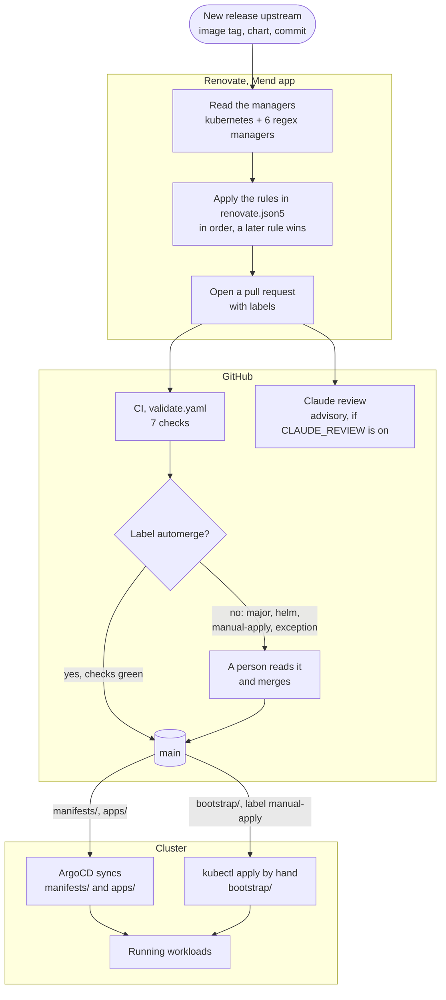
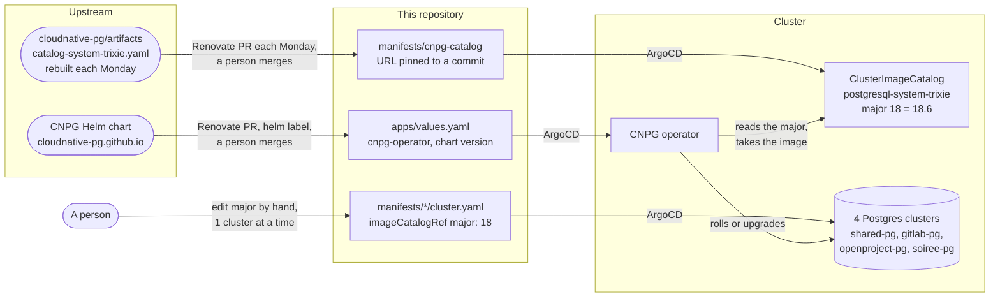

# Renovate

This file describes how Renovate keeps the versions in this repository current. It says what Renovate reads, which bump merges itself, which bump waits for a person, and why. Read it before you change `renovate.json5` or merge a Renovate pull request. The rules were read from `renovate.json5` on 2026-10-29.

## Documents

| Document | Read it when |
|---|---|
| [`README.md`](README.md) | You need the application inventory or the CI checks. |
| [`../../renovate.json5`](../../renovate.json5) | You change a rule. Each rule has a comment that gives its reason. |
| [`../../REVIEW.md`](../../REVIEW.md) | You want the checklist of the Claude review for a Renovate pull request. |
| [`../incidents/2026-10-21-renovate-frozen-by-tag-suffix.md`](../incidents/2026-10-21-renovate-frozen-by-tag-suffix.md) | Renovate opens no pull request for an image that has newer tags. |
| [`../incidents/2026-10-29-cnpg-image-frozen-at-creation.md`](../incidents/2026-10-29-cnpg-image-frozen-at-creation.md) | You upgrade Postgres, or a Postgres image looks old. |
| [`../incidents/2026-10-26-bootstrap-bump-without-apply-note.md`](../incidents/2026-10-26-bootstrap-bump-without-apply-note.md) | You merge a bump of a file under `bootstrap/`. |
| [`../incidents/2026-09-18-external-dns-annotation-prefix.md`](../incidents/2026-09-18-external-dns-annotation-prefix.md) | You want an example of an automerged bump that broke a service. |

## At a glance

| Item | Value |
|---|---|
| Runs as | The Mend Renovate GitHub app. It has a job log at `developer.mend.io`. |
| Base branch | `main`. |
| Presets | `config:recommended`, `docker:enableMajor`, `:separateMultipleMajorReleases`. |
| Labels | Each pull request gets `renovate` and `dependencies`. A rule can replace them. |
| Merges itself | A patch bump of any kind, and a minor bump of a container image. These carry the `automerge` label. |
| Waits for a person | Every major bump, every Helm chart bump, every file under `bootstrap/`, and the exceptions in [Rules](#rules). |
| Postgres | The CNPG operator chart and the image catalog of CNPG. Both wait for a person. A Postgres major is never a Renovate bump. |

## How a bump reaches the cluster



NOTE: ArgoCD does not manage `bootstrap/`. A merge there changes git and leaves the cluster on the old version. The pull request body gives the apply command.

NOTE: The Claude review skips a bump with the `automerge` label, because no person reads it. It still runs if the bump also has `helm`, `major` or `manual-apply`.

## What Renovate reads

| Manager | Files | Finds |
|---|---|---|
| `kubernetes` | `manifests/**/*.yaml`, `bootstrap/argocd/install.yaml`, `bootstrap/argocd/repo-server-ksops-patch.yaml` | Each `image:` key. |
| regex, Helm charts | `apps/values.yaml` | Each `repoURL`, `chart` and `targetRevision` of a Helm Application. |
| regex, KSOPS | `bootstrap/argocd/repo-server-ksops-patch.yaml` | `KSOPS_VERSION`, from the GitHub releases of `viaduct-ai/kustomize-sops`. |
| regex, CI tools | `.github/workflows/*.yaml` | A `*_VERSION` env var under a `# renovate:` comment, for example `KUBECONFORM_VERSION`. |
| regex, runner job image | `apps/values.yaml` | The `image = "..."` line in the TOML of `gitlab-runner`. |
| regex, fail2ban plugin | `apps/values.yaml` | The version of the Traefik plugin `tomMoulard/fail2ban`. |
| regex, pinned commits | `apps/values.yaml`, `manifests/cnpg-catalog/kustomization.yaml` | A `raw.githubusercontent.com` URL with a 40-character commit. Renovate moves it to the head of `main`. This covers the CNPG Grafana dashboard and the CNPG image catalog. |

CAUTION: Renovate reads only what these managers match. A version that no file names, or that sits in a key that no manager reads, gets no pull request and no warning. 2 incidents came from this gap. See [When Renovate stays silent](#when-renovate-stays-silent).

## Rules

The rules apply in order. A later rule replaces the `labels` of an earlier one. It keeps the `groupName` of an earlier one, unless it sets its own.

| # | Applies to | Effect | Reason |
|---|---|---|---|
| 1 | Every patch bump | Automerge, group `patch updates`, label `automerge`. | A patch bump is a bug fix. |
| 2 | A minor bump of a container image | Automerge, label `automerge`. | A minor image bump keeps compatibility. |
| 3 | `go-practice-web` and `go-practice-runner` | 1 group, a person merges. | The 2 images share an API and move together. |
| 4 | `nginx` in `truenas-ui` and `truenas-smb` | A person merges. | The relays carry the access to the NAS. CI does not run nginx. |
| 5 | Every major bump | A person merges, label `major`. | A major bump can break compatibility. |
| 6 | Every Helm chart | A person merges, label `helm`. | A chart bump can change many objects at once. |
| 7 | KSOPS | A person merges, then applies. Label `manual-apply`. | `KSOPS_SHA256` needs an update by hand. CI fails until it matches. |
| 8 | ArgoCD | A person merges, then applies. Label `manual-apply`. Versioning `semver`. | `bootstrap/` is not managed by ArgoCD. Docker versioning rejected the stable tags after an `-rc` pin. |
| 9 | Every other image under `bootstrap/` | A person merges, then applies. Label `manual-apply`. | The same reason as rule 8. |
| 10 | Jellyfin | Regex versioning. | Jellyfin went from `10.11.11` to `12.0`. Docker versioning needs the same number of segments. |
| 11, 12 | qBittorrent | Regex versioning. A person merges a patch or a minor. | The tag carries the libtorrent version and a build counter. libtorrent writes the resume data. |
| 13 to 18 | Sonarr, Radarr, Prowlarr | Regex versioning. A person merges a patch or a minor. | The tag carries a LinuxServer build counter. Each app migrates its database at start. The database is on `shared-pg`. |
| 19 | Seerr | A person merges a patch or a minor. | Seerr migrates its database at start. The database is on `shared-pg`. |
| 20 | shelly-control | A person merges a patch or a minor. | It switches the relay of the boiler. |
| 21 | The CNPG image catalog | 1 pull request a week, Monday after 12:00 UTC. A person merges. | The merge restarts every Postgres cluster once. |

## Postgres and CNPG

3 versions decide what runs in a CNPG cluster. Each one moves in its own way.



| What moves | Where | Renovate | Effect of the merge |
|---|---|---|---|
| CNPG operator | `apps/values.yaml`, chart `cloudnative-pg` | Yes, label `helm`. | The operator restarts. It can restart the pods of each cluster, to update the instance manager. |
| Postgres minor and image rebuild | `manifests/cnpg-catalog/kustomization.yaml` | Yes, once a week. | Each cluster on that major restarts once. The replicas go first, then the primary. Writes stop for about 3.5 minutes per cluster. |
| Postgres major | `imageCatalogRef.major` in 1 `cluster.yaml` | No. | An offline in-place upgrade with `pg_upgrade`. The cluster is down until it ends. |

NOTE: If a catalog pull request comes from a commit that did not change the catalog file, the merge restarts nothing.

WARNING: A change of `major` stops every instance of that cluster. Change 1 cluster at a time. Follow the steps in [`../incidents/2026-10-29-cnpg-image-frozen-at-creation.md`](../incidents/2026-10-29-cnpg-image-frozen-at-creation.md): make sure that a backup exists, then run `vacuumdb --all --analyze-in-stages --missing-stats-only`, then take a new base backup.

## When Renovate stays silent

Renovate reports nothing when it opens no pull request. A frozen version looks the same as a current one. Each case so far was found by a person who asked about a version.

| Cause | Example | Write-up |
|---|---|---|
| A tag suffix that changes with each build | `5.1.4-r2-ls440` for qBittorrent | [`2026-10-21-renovate-frozen-by-tag-suffix.md`](../incidents/2026-10-21-renovate-frozen-by-tag-suffix.md) |
| A prerelease pin | `v3.4.0-rc7` for ArgoCD | the comment on rule 8 |
| A new number of version segments | `10.11.11` to `12.0` for Jellyfin | the comment on rule 10 |
| A version that no file names | the CNPG webhook wrote `18.3` into each Cluster at creation | [`2026-10-29-cnpg-image-frozen-at-creation.md`](../incidents/2026-10-29-cnpg-image-frozen-at-creation.md) |

To find the next one:

1. Open the Renovate dashboard issue in the repository. It lists each dependency that Renovate cannot resolve.
2. Compare a running version with the newest release upstream. A version many releases behind is the signal.
3. Before you commit a new pin, read its tag. A build counter, a date or a prerelease in the tag can freeze Renovate.

## How to change a rule

1. Edit `renovate.json5`. Put a comment on the rule that gives the reason.
2. If the rule sets `labels`, keep `renovate` and `dependencies`. Add `automerge` only together with `automerge: true`. The Claude review reads the label, not the setting.
3. Validate the file:

   ```sh
   npx --yes -p renovate renovate-config-validator --strict renovate.json5
   ```

4. Update the table in [Rules](#rules).

Expected result: the validator prints `Config validated successfully`.
